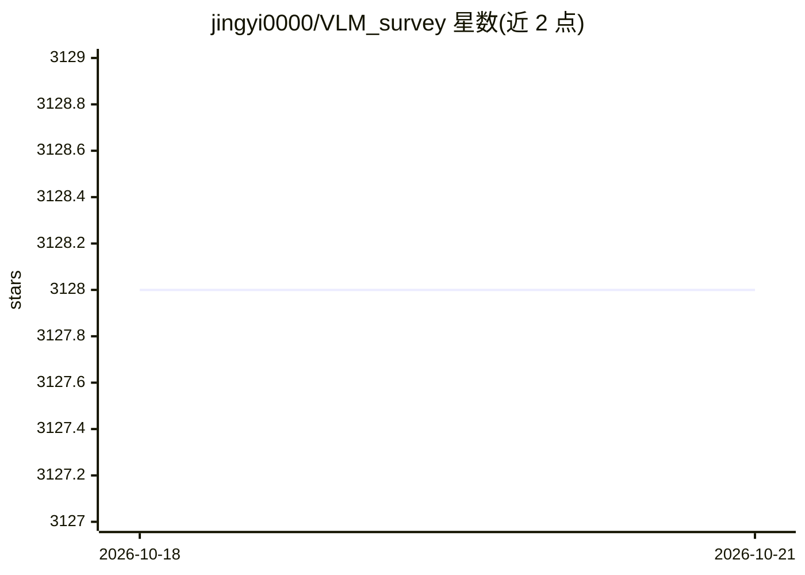

# jingyi0000/VLM_survey

⭐ 3,128 · 推送 2026-10-05 · [GitHub](https://github.com/jingyi0000/VLM_survey) · 组织维护

**视觉语言模型（VLM）视觉任务综述的配套论文清单**

TPAMI 2024 论文《Vision-Language Models for Vision Tasks: A Survey》的配套仓库：按 VLM 预训练、迁移学习、知识蒸馏、合成数据等类别收录论文及代码链接，并整理 VLM 预训练与评测数据集（含图像分类、图文检索、动作识别、目标检测、语义分割）的规模与评测指标表。面向计算机视觉研究者，通过 PR 收录新论文，README 标注最后更新时间并维护 arXiv 版本计划。

## 筛选速览

| 维度 | 判定 | 备注 |
|---|---|---|
| AI 角色 | `ai-knowledge` | 知识聚合/清单类 |
| 许可风险 | `none` | — |
| 部署形态 | `None` |  |
| 模型依赖 | — | README 未给出锁定关系 |
| 硬件要求 | — | 无带数字的原话,不猜 |
| 安装摩擦 | `low` | 无编译、无系统依赖或容器化 |
| 成熟度 | — | 结构信号不足 |

## 能力要点

- 配套 TPAMI 2024 综述论文，系统覆盖 VLM 预训练/迁移学习/知识蒸馏方法
- 收录论文按会议与主题分类并附代码链接
- 整理 VLM 预训练与多任务评测数据集表格（规模/语言/指标）
- 通过 PR 流程持续收录新论文

## 适用场景

- 查找 VLM 在分类、检测、分割等任务上的方法与代码
- 了解 VLM 预训练与评测常用数据集及指标
- 跟进 VLM 与合成数据方向的新论文

## 场景标签

`精选清单` · 领域:学习与行业

## 证据(README 行号)

> L3: This is the repository of **Vision Language Models for Vision Tasks: a Survey**, a systematic survey of VLM studies 
> L86: Most visual recognition studies rely heavily on crowd-labelled data in deep neural networks (DNNs) training, and th

## 星数曲线

2026-10-18 3,128 → 2026-10-21 3,128（+0）

---
*卡片 v1 · prompt 1.4 · 生成 2026-10-20 · 置信度 high · 依据 README sha `840d5f72ad86` · [字段定义](../../DATASET.md)*
