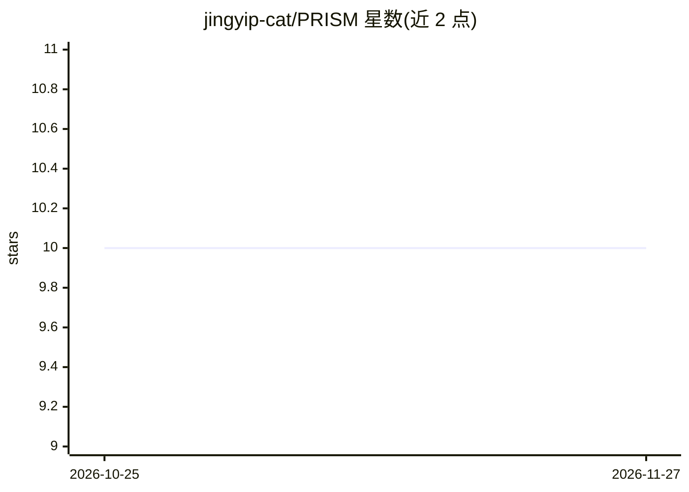

# jingyip-cat/PRISM

⭐ 10 · Python · MIT · 推送 2026-05-22 · [GitHub](https://github.com/jingyip-cat/PRISM) · [官网](https://jingyip-cat.github.io/PRISM/) · 组织维护

**面向长程 LLM Agent 的免训练检索侧记忆框架**

PRISM（Python 包名 mmem）是一个免训练、作用于检索侧的记忆框架，在已构建的图记忆上运行，将长程记忆处理为检索与压缩的联合问题。由四个推理时模块组成：分层束搜索、查询敏感边代价、证据压缩、自适应意图路由；每查询最多两次 LLM 调用，多数查询走零 LLM 层级。无需微调、无需改动上游写入管道，可接入暴露节点/边模式的任意后端。要求 Python 3.10+ 与 OpenAI 兼容 API key，仅 CPU 运行。

## 筛选速览

| 维度 | 判定 | 备注 |
|---|---|---|
| AI 角色 | `ai-ecosystem` | LLM/agent 周边工具 |
| 许可风险 | `permissive` | MIT |
| 部署形态 | `library` | 以包/库形式分发 |
| 模型依赖 | — | README 未给出锁定关系 |
| 硬件要求 | `cpu-ok` | |
| 安装摩擦 | `low` | 无编译、无系统依赖或容器化 |
| 成熟度 | — | 结构信号不足 |

## 能力要点

- 免训练、检索侧框架，即插即用于已构建的图记忆后端
- 四模块组合：分层束搜索 / 查询敏感边代价 / 证据压缩 / 自适应意图路由
- 每查询最多两次 LLM 调用，多数查询经零 LLM 层级处理
- 提供 LoCoMo 基准复现脚本与消融配置，PYTHONHASHSEED=0 保证可复现

## 适用场景

- 为长对话 Agent 提供小上下文预算下的记忆检索
- 在已有图记忆后端上替换检索方案而无需重新摄取
- 按论文消融配置复现 LoCoMo 基准实验

## 场景标签

`知识图谱` `RAG` `Agent 记忆` · 领域:Agent 开发

## 证据(README 行号)

> L25: **PRISM** occupies that corner. It is a *training-free, retrieval-side* framework that operates over an already-con
> L27: PRISM composes **four orthogonal inference-time modules**:

## 星数曲线

2026-10-25 10 → 2026-11-27 10（+0）

---
*卡片 v1 · prompt 1.4 · 生成 2026-11-19 · 置信度 mid · 依据 README sha `9002f0b7b199` · [字段定义](../../DATASET.md)*
