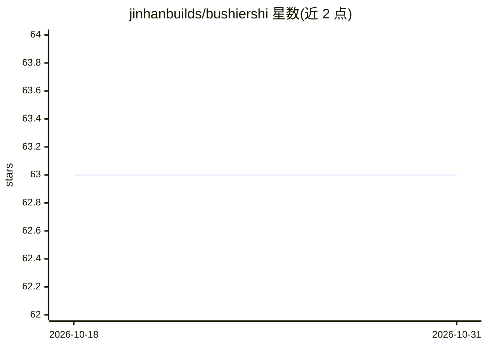

# jinhanbuilds/bushiershi

⭐ 63 · MIT · 推送 2026-08-26 · [GitHub](https://github.com/jinhanbuilds/bushiershi) · 个人维护 · 中文 README

**对抗中文写作 AI 味表达习惯的 Agent Skill**

面向 Agent 客户端的中文改写/生成技能包，仅在显式调用 $bushiershi 时生效。作者基于三年多用 GPT 的真实任务中反复纠正的表达问题整理而成：约束成稿直接进入事情、让具体主体做主语、判断带依据出现，并列举虚设反面、价值报幕、强行升华等需避免的写作动作；同时规定必须保留用户原话、事实数字、立场程度与不确定性。通过 npx skills 或手动复制到 Skills 目录安装，不建立禁词表，仅控制最终成稿。

## 筛选速览

| 维度 | 判定 | 备注 |
|---|---|---|
| AI 角色 | `ai-ecosystem` | LLM/agent 周边工具 |
| 许可风险 | `permissive` | MIT |
| 部署形态 | `library` | 以包/库形式分发 |
| 模型依赖 | — | README 未给出锁定关系 |
| 硬件要求 | — | 无带数字的原话,不猜 |
| 安装摩擦 | `low` | 无编译、无系统依赖或容器化 |
| 成熟度 | `idea` | |

## 能力要点

- 仅显式调用 $bushiershi 生效的 Agent Skill
- 定义需避免的 8 类写作动作（虚设反面、价值报幕、强行升华等）与必须保留的内容清单
- npx skills 一键安装到项目 .agents/skills 目录
- 不以禁词表或固定句式实现，按句子的实际功能判断修改

## 适用场景

- 让 Agent 改写中文成稿时去除 AI 味表达
- 从事实材料生成面向用户的中文说明
- 处理会议纪要等真实中文文本

## 场景标签

`AI 写作` · 领域:内容生成

## 证据(README 行号)

> L3: `bushiershi` 是一个对抗模型输出不良表达习惯的 Agent Skill。
> L45: 在请求中明确调用 `$bushiershi`：

## 星数曲线

2026-10-18 63 → 2026-10-31 63（+0）

---
*卡片 v1 · prompt 1.4 · 生成 2026-10-24 · 置信度 high · 依据 README sha `eee3dcc09315` · [字段定义](../../DATASET.md)*
