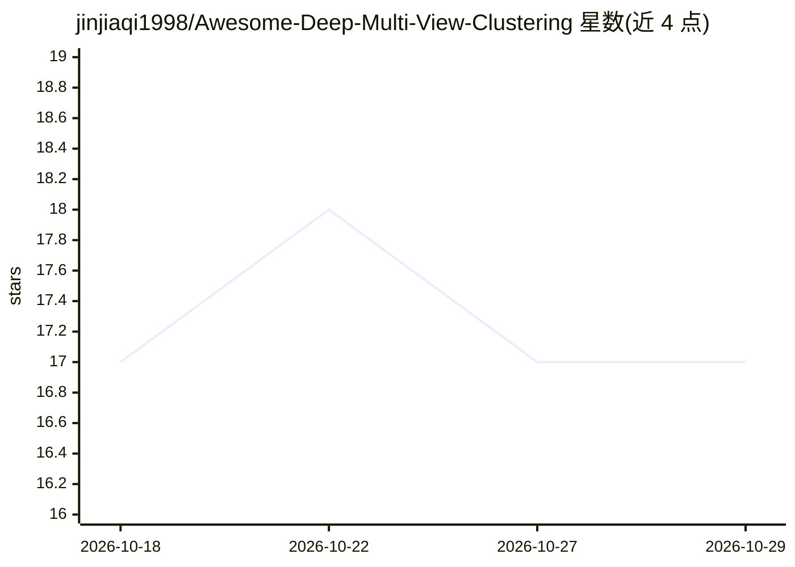

# jinjiaqi1998/Awesome-Deep-Multi-View-Clustering

⭐ 17 · 推送 2026-09-10 · [GitHub](https://github.com/jinjiaqi1998/Awesome-Deep-Multi-View-Clustering) · 个人维护 · 中文 README

**深度多视图聚类论文与代码的策展清单（面向科研人员）**

由个人维护（国防科大邮箱联系）的论文/代码聚合清单：收录基于深度神经网络的多视图聚类方法，按数据完整性分为完整多视图聚类（DMVC）与不完整多视图聚类（DIMVC）两大类；条目含年份、简称、发表会议/期刊、论文与代码链接（部分仅有论文）。另设综述（Surveys）板块收录 2013-2025 年的综述论文。面向多视图聚类方向的研究者选型与文献调研，仓库本身不含可运行代码，仅提供索引与联系方式，使用其内容需引用指定论文。

## 筛选速览

| 维度 | 判定 | 备注 |
|---|---|---|
| AI 角色 | `ai-knowledge` | 知识聚合/清单类 |
| 许可风险 | `none` | — |
| 部署形态 | `None` |  |
| 模型依赖 | — | README 未给出锁定关系 |
| 硬件要求 | — | 无带数字的原话,不猜 |
| 安装摩擦 | `low` | 无编译、无系统依赖或容器化 |
| 成熟度 | — | 结构信号不足 |

## 能力要点

- 按 DMVC / DIMVC 两大类组织深度多视图聚类论文与代码条目
- 收录条目含年份、方法简称、发表会议/期刊与代码链接
- 单独的综述板块覆盖 2013-2025 年多视图聚类与多模态学习综述

## 适用场景

- 查找多视图聚类方向的最新方法论文与开源代码
- 调研该领域历年综述以了解研究脉络
- 按会议/期刊（ICML/NeurIPS/CVPR/TPAMI 等）筛选方法

## 场景标签

`科研工具` `精选清单` · 领域:学习与行业

## 证据(README 行号)

> L2: Collections for state-of-the-art and novel deep neural network-based multi-view clustering approaches (papers & code
> L38: ## Papers & Codes

## 星数曲线

2026-10-18 17 → 2026-10-29 17（+0）

---
*卡片 v1 · prompt 1.4 · 生成 2026-10-29 · 置信度 high · 依据 README sha `e5e95a404223` · [字段定义](../../DATASET.md)*
