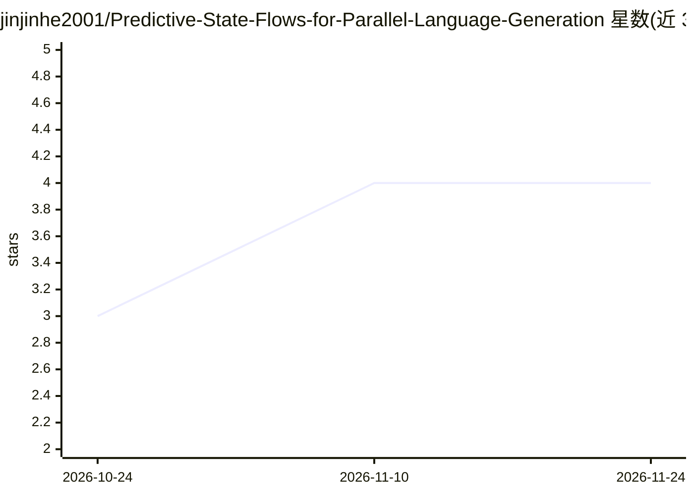

# jinjinhe2001/Predictive-State-Flows-for-Parallel-Language-Generation

⭐ — · [GitHub]() · 组织维护

**面向研究者的并行文本生成扩散语言模型 PSF 官方实现**

论文 Predictive-State Flows 的代码与权重库：流先验从噪声生成 K 个预测状态，块解码器并行写出全部文本块，扩散仅作用于 K<<L 个状态而非逐 token 状态。仓库提供 11 个预训练 checkpoint、推理与采样脚本、按论文完整配方的训练脚本、生成困惑度/MAUVE/FLOPs 等评测工具，以及含 toy 模式的 CPU 快速测试。MIT 许可，依托 PyTorch 实现，数据使用 ELF 预分词的 OpenWebText。

## 筛选速览

| 维度 | 判定 | 备注 |
|---|---|---|
| AI 角色 | `ai-native` | 本体是模型或模型工具 |
| 许可风险 | `permissive` | — |
| 部署形态 | `library` | 以包/库形式分发 |
| 模型依赖 | — | README 未给出锁定关系 |
| 硬件要求 | — | 无带数字的原话,不猜 |
| 安装摩擦 | `low` | 无编译、无系统依赖或容器化 |
| 成熟度 | — | 结构信号不足 |

## 能力要点

- 流先验生成 K 个预测状态、块解码器全并行写出的文本生成模型
- 提供 11 个预训练 checkpoint（197M/677M，Hugging Face 下载）
- 覆盖训练、采样、评测（生成困惑度、MAUVE、FLOPs/延迟）的完整脚本
- states-only 采样与 states-only prior 变体 checkpoint

## 适用场景

- 复现论文中的并行文本生成实验结果
- 在自有数据上训练或微调预测状态流模型
- 对比非自回归/扩散语言模型的生成质量与速度

## 场景标签

`模型训练` `模型评测` · 领域:评测与运维

## 证据(README 行号)

> L21: A flow prior generates all K states jointly from noise, and a block decoder then generates the K blocks in parallel
> L43: the diffusion prior generates only *predictive information* about the upcoming text, and a decoder makes the
> L116: python -m scripts.eval_gen --ckpt checkpoints/psf_k8.pt $(cat configs/models/psf_k8.args) \

## 星数曲线

2026-10-24 3 → 2026-11-24 4（+1）

---
*卡片 v1 · prompt 1.4 · 生成 2026-11-21 · 置信度 high · 依据 README sha `0af7a04325f7` · [字段定义](../../DATASET.md)*
