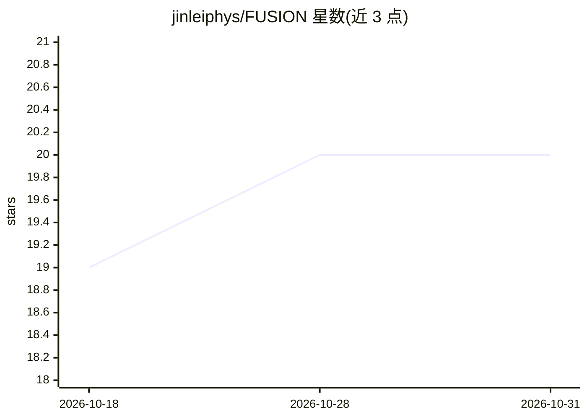

# jinleiphys/FUSION

⭐ 20 · Shell · NOASSERTION · 推送 2026-10-30 · [GitHub](https://github.com/jinleiphys/FUSION) · [官网](https://vibeinscience.com/) · 组织维护 · 中文 README

**核物理 AI 代理技能插件：驱动 28 个科学代码与 6.1 万页离线文献**

面向核物理研究者的编码代理插件：为 28 个场景提供专家技能，其中 20 个驱动 FRESCO、TALYS、SMASH 等开源核物理代码，教会代理安装、编写输入、运行、解析输出并按基准验证；另含贝叶斯 UQ、EXFOR 数据检索、6.1 万页 arXiv nucl-th 离线知识库（约 250 MB，首次使用下载）及文献检索技能。以 SKILL.md 通用格式交付，可装入 Claude Code、Codex、Antigravity、opencode 等代理。限制：v0.2.0 为 beta，冷启动安装欠测试，TALYS 需约 11 GB 磁盘。

## 筛选速览

| 维度 | 判定 | 备注 |
|---|---|---|
| AI 角色 | `ai-ecosystem` | LLM/agent 周边工具 |
| 许可风险 | `none` | NOASSERTION |
| 部署形态 | `None` |  |
| 模型依赖 | locked-api |  |
| 硬件要求 | — | 无带数字的原话,不猜 |
| 安装摩擦 | `low` | 无编译、无系统依赖或容器化 |
| 成熟度 | `idea` | |

## 能力要点

- 28 个技能：每代码一项，覆盖安装/输入/运行/解析/基准验证
- 61,167 页 nucl-th 离线文献库，纯 grep 检索，无服务无 API key
- 技能按 SKILL.md 通用格式提供，兼容多种编码代理
- 每技能经两平台验证与对抗性审查，验证记录写入 references/verification.md

## 适用场景

- 让编码代理从源码安装并正确运行核物理计算代码
- 离线检索 nucl-th 文献并核验引用
- 对比计算结果与 EXFOR 实验数据
- 运行贝叶斯不确定度量化流程

## 场景标签

`编码 Agent` `科研工具` · 领域:编码与开发

## 证据(README 行号)

> L69: FUSION ships one expert skill per code. Each teaches an agent to install that
> L76: FUSION is a plugin. There is nothing to build and no separate program: you add
> L138: FUSION's skills follow the common `SKILL.md` format (a folder per skill with a

## 星数曲线

2026-10-18 19 → 2026-10-31 20（+1）

---
*卡片 v1 · prompt 1.4 · 生成 2026-10-28 · 置信度 high · 依据 README sha `299586e9123e` · [字段定义](../../DATASET.md)*
