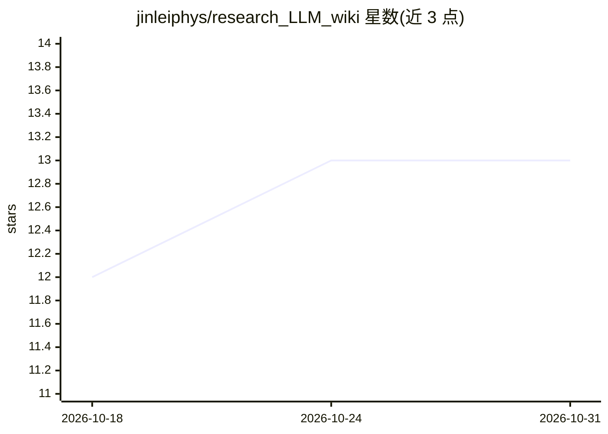

# jinleiphys/research_LLM_wiki

⭐ 13 · Shell · MIT · 推送 2026-06-24 · [GitHub](https://github.com/jinleiphys/research_LLM_wiki) · 个人维护 · 中文 README

**科研者的 agent 技能：把阅读与研究史变成 LLM 维护的 markdown wiki**

一对跨 harness（Claude Code + Codex CLI）的 agent 技能，将科学文献阅读与个人研究历史沉淀为持久化、结构化、LLM 维护的 markdown wiki，替代一次性 RAG 检索。literature-wiki 追踪领域级知识（论文、实体、方法、争论页），按需调用；research-profile 记录个人研究组合（项目、想法、失败、合作者），profile.md 自动加载进每个新会话。两技能可交叉链接，模式源自 Andrej Karpathy 的 LLM Wiki gist。作者自述仅经双 harness 安装的 vibe 测试，尚无正式评测套件；安装细节在各技能自己的 README 中。

## 筛选速览

| 维度 | 判定 | 备注 |
|---|---|---|
| AI 角色 | `ai-ecosystem` | LLM/agent 周边工具 |
| 许可风险 | `permissive` | MIT |
| 部署形态 | `None` |  |
| 模型依赖 | — | README 未给出锁定关系 |
| 硬件要求 | — | 无带数字的原话,不猜 |
| 安装摩擦 | `low` | 无编译、无系统依赖或容器化 |
| 成熟度 | `idea` | |

## 能力要点

- 双技能分工：领域级 literature-wiki + 个人 research-profile
- research-profile 的 profile.md 自动加载到每个新会话
- 同时提供 SKILL.md（Claude Code）与 AGENTS.md（Codex CLI）入口
- 文献 wiki 与个人研究组合页面可交叉链接

## 适用场景

- 长期跟踪某领域文献，让助手在持续维护的 wiki 上回答问题
- 让 AI 助手每个会话都了解我的研究经历，无需重复说明
- 记录未发表想法、失败尝试与合作者笔记作为私有知识库

## 场景标签

`科研工具` `知识库管理` · 领域:知识与检索

## 证据(README 行号)

> L5: A pair of cross-harness agent skills (**Claude Code** + **Codex CLI**) that turn your scientific reading and your ow
> L48: - `SKILL.md` — Claude Code entry (with YAML frontmatter for the trigger system)

## 星数曲线

2026-10-18 12 → 2026-10-31 13（+1）

---
*卡片 v1 · prompt 1.4 · 生成 2026-10-31 · 置信度 high · 依据 README sha `7ca321824021` · [字段定义](../../DATASET.md)*
