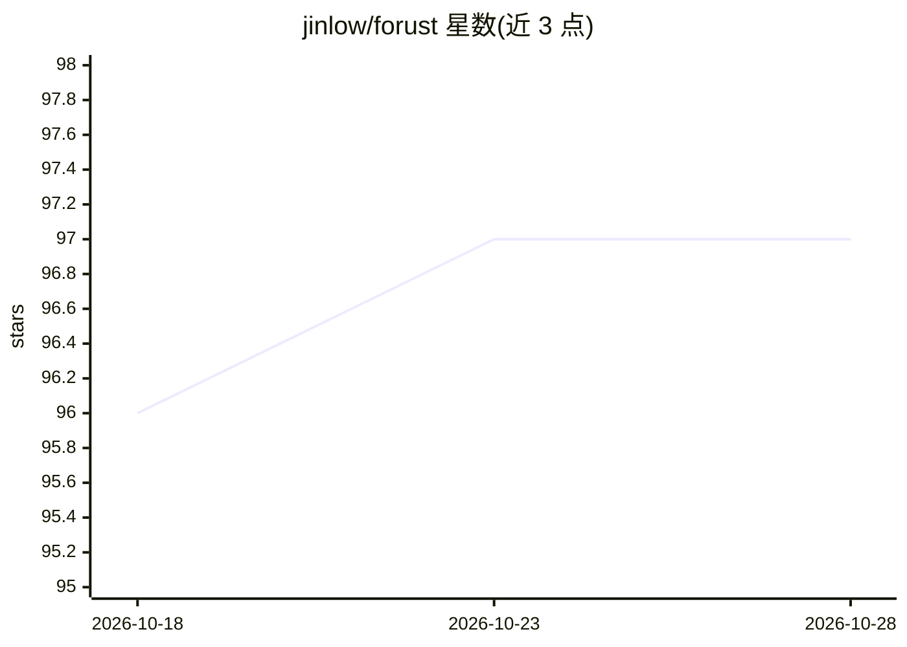

# jinlow/forust

⭐ 97 · Rust · Apache-2.0 · 推送 2026-10-13 · [GitHub](https://github.com/jinlow/forust) · [官网](https://jinlow.github.io/forust/) · 个人维护

**Rust 实现的轻量梯度提升决策树（GBDT）Python 包**

用于训练梯度提升决策树集成的库，算法代码以 Rust 编写并提供 Python 封装（GradientBooster 类），支持多种目标函数、early stopping、GOSS 采样加速训练、单调约束、partial dependence、特征重要度计算，以及 JSON 格式模型保存加载。实现与 XGBoost 相同的算法，作者以学习该算法和在小代码库中实验新功能为开发目的。Rust 侧可通过 Cargo 直接使用，文档另提供自包含 Rust 示例。

## 筛选速览

| 维度 | 判定 | 备注 |
|---|---|---|
| AI 角色 | `ai-native` | 本体是模型或模型工具 |
| 许可风险 | `permissive` | Apache-2.0 |
| 部署形态 | `library` | 以包/库形式分发 |
| 模型依赖 | — | README 未给出锁定关系 |
| 硬件要求 | — | 无带数字的原话,不猜 |
| 安装摩擦 | `low` | 无编译、无系统依赖或容器化 |
| 成熟度 | — | 结构信号不足 |

## 能力要点

- 算法核心 Rust 实现，提供 Python 封装与 Cargo 直接使用两种途径
- 实现与 XGBoost 相同的算法
- 支持 GOSS 采样、单调约束、early stopping
- 模型以 JSON 保存/加载，支持 text_dump/json_dump 树结构输出与 partial dependence 分析

## 适用场景

- 训练梯度提升决策树模型并预测
- 查看单棵树结构与特征重要度，理解模型行为
- 在大数据集上用 GOSS 采样加速训练

## 场景标签

`模型训练` · 领域:训练与推理

## 证据(README 行号)

> L6: Forust, is a lightweight package for building gradient boosted decision tree ensembles. All of the algorithm code is
> L30: The `GradientBooster` class is currently the only public facing class in the package, and can be used to train grad

## 星数曲线

2026-10-18 96 → 2026-10-28 97（+1）

---
*卡片 v1 · prompt 1.4 · 生成 2026-10-23 · 置信度 high · 依据 README sha `23b8c4f39eed` · [字段定义](../../DATASET.md)*
