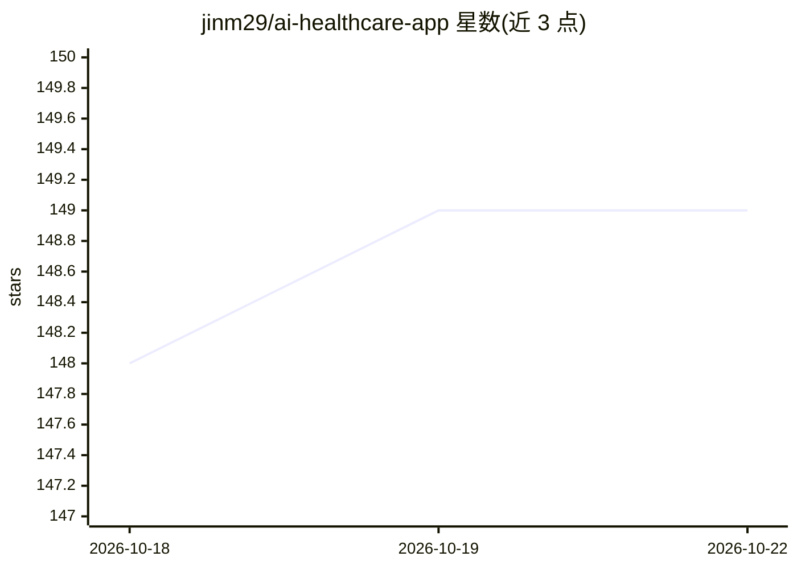

# jinm29/ai-healthcare-app

⭐ 149 · TypeScript · AGPL-3.0 · 推送 2026-09-14 · [GitHub](https://github.com/jinm29/ai-healthcare-app) · 组织维护

**可自托管的健康数据平台：医疗记录+AI 对话**

基于 Next.js 15、TypeScript、PostgreSQL 的健康数据平台：上传化验单、体检报告等 PDF/图片，自动解析为结构化 JSON，随后以该数据为上下文与多家 LLM 对话。支持 OpenAI、Anthropic、Gemini 及本地 Ollama，可完全本地运行（Docling 解析 + Ollama 推理），也支持云端模式（Vercel Blob + Trigger.dev）。API 密钥以 AES-256-CBC 加密存储，Redis 缓存可选并支持优雅降级。提供 10 种语言界面。声明为信息工具，不能替代医疗建议。

## 筛选速览

| 维度 | 判定 | 备注 |
|---|---|---|
| AI 角色 | `ai-native` | 本体是模型或模型工具 |
| 许可风险 | `viral` | AGPL-3.0 |
| 部署形态 | `self-host` | docker 或自建部署 |
| 模型依赖 | local-ok | 支持本地模型 |
| 硬件要求 | — | 无带数字的原话,不猜 |
| 安装摩擦 | `low` | 无编译、无系统依赖或容器化 |
| 成熟度 | — | 结构信号不足 |

## 能力要点

- PDF/图片上传并自动解析为结构化 JSON 健康记录
- 多 LLM 供应商支持（OpenAI/Anthropic/Gemini/Ollama 本地）
- 完全本地部署模式（Docling + Ollama，无需云服务）
- LLM API 密钥 AES-256-CBC 加密存储，Redis 缓存可选

## 适用场景

- 把体检报告和化验单集中管理并与 AI 对话提问
- 在本地完全离线运行以保护健康数据隐私
- 自托管个人健康数据平台替代云端 SaaS

## 场景标签

`文档解析` `文档问答` `知识库管理` · 领域:知识与检索

## 证据(README 行号)

> L3: A self-hostable health data platform that combines structured medical records with AI-assisted conversations. Upload
> L14: |**Multi-provider LLM support**|OpenAI, Anthropic, Google Gemini, and Ollama (local)|
> L15: |**Privacy-first deployment**|Run fully local with Docling + Ollama — no cloud required|

## 星数曲线

2026-10-18 148 → 2026-10-22 149（+1）

---
*卡片 v1 · prompt 1.4 · 生成 2026-10-22 · 置信度 high · 依据 README sha `014e9bcd1b75` · [字段定义](../../DATASET.md)*
