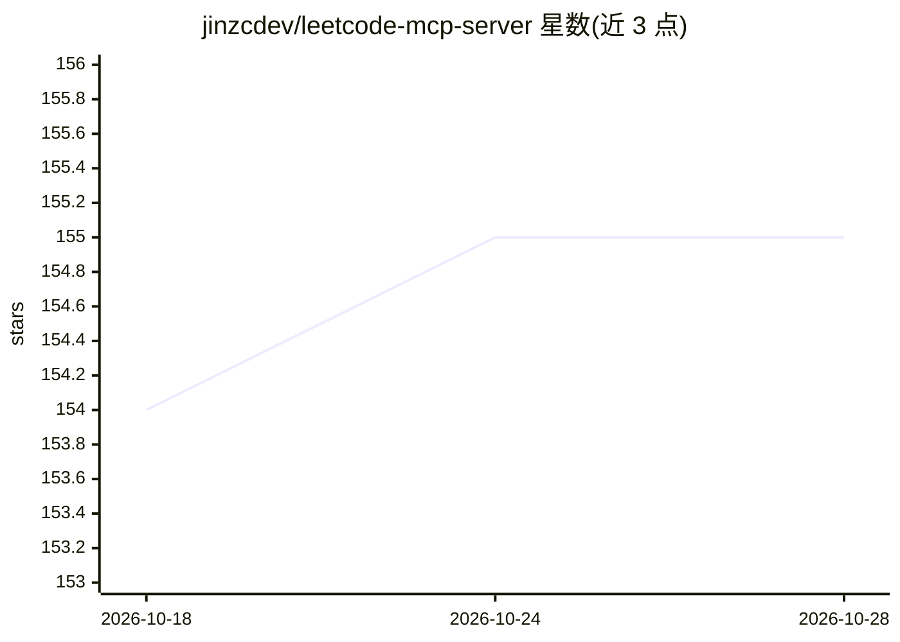

# jinzcdev/leetcode-mcp-server

⭐ 155 · TypeScript · MIT · 推送 2026-10-18 · [GitHub](https://github.com/jinzcdev/leetcode-mcp-server) · [官网](https://www.npmjs.com/package/@jinzcdev/leetcode-mcp-server) · 个人维护 · 中文 README

**为 MCP 客户端接入 LeetCode 题目与用户数据的工具服务器**

基于 Model Context Protocol 的服务器，向 MCP 客户端暴露 20 余个工具：获取题目详情、每日一题、按标签/难度/关键词搜索，读取用户资料、竞赛排名与提交历史；认证后可运行/提交代码、管理笔记与题目清单。支持 leetcode.com 与 leetcode.cn 双站点（部分工具仅限某站），提供 stdio 与 Streamable HTTP 两种传输模式，可通过 npm 全局安装或从源码克隆运行；需 Node.js v20 以上，认证功能依赖可选的 LeetCode session cookie。

## 筛选速览

| 维度 | 判定 | 备注 |
|---|---|---|
| AI 角色 | `ai-ecosystem` | LLM/agent 周边工具 |
| 许可风险 | `permissive` | MIT |
| 部署形态 | `library` | 以包/库形式分发 |
| 模型依赖 | — | README 未给出锁定关系 |
| 硬件要求 | — | 无带数字的原话,不猜 |
| 安装摩擦 | `low` | 无编译、无系统依赖或容器化 |
| 成熟度 | — | 结构信号不足 |

## 能力要点

- 覆盖题目/用户/提交/笔记/题单/题解六大类 20+ 工具
- 支持 leetcode.com 与 leetcode.cn 双站点
- stdio 与 Streamable HTTP 两种传输模式
- 认证后可运行代码、提交题解并轮询获取结果

## 适用场景

- 在 MCP 客户端（如 Claude）中查询 LeetCode 题目与题解
- 让 AI 助手代为提交代码并获取判题结果
- 跟踪自己的刷题进度与竞赛排名

## 场景标签

 · 领域:开发者工具/编程学习

## 证据(README 行号)

> L10: The LeetCode MCP Server is a Model Context Protocol (MCP) server that provides seamless integration with LeetCode A
> L14: - 🌐 **Multi-site Support**: Support​ both leetcode.com (Global) and leetcode.cn (China) platforms

## 星数曲线

2026-10-18 154 → 2026-10-28 155（+1）

---
*卡片 v1 · prompt 1.4 · 生成 2026-10-22 · 置信度 high · 依据 README sha `2dc92e482d14` · [字段定义](../../DATASET.md)*
