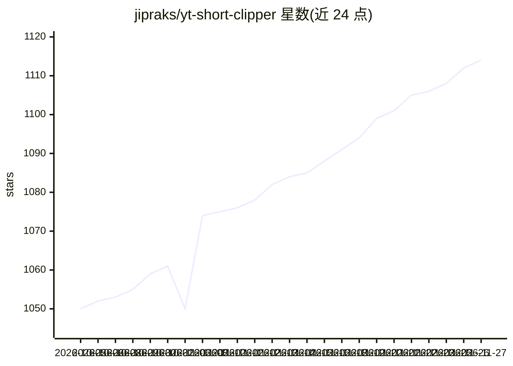

# jipraks/yt-short-clipper

⭐ 1,114 · TypeScript · MIT · 推送 2026-11-26 · [GitHub](https://github.com/jipraks/yt-short-clipper) · 个人维护

**面向内容创作者的 Windows 桌面应用：将长视频转为带字幕的 9:16 短视频剪辑**

Cuplik（原 YT Short Clipper v2）是 Windows 桌面应用，用户粘贴 YouTube URL 并提供 cookies.txt 后，由 yt-dlp 获取视频与字幕，LLM 读取转录文本挑选 58-120s 高光片段，切分后重构成 9:16 竖屏（MediaPipe 人脸追踪/居中/模糊填充三种模式），烧录逐词字幕并输出 MP4，可选通过 Repliz 上传与定时发布。技术栈为 React 19 + Tauri v2 + Python sidecar。仅支持 Windows，处于 beta 状态，版本间可能有破坏性变更。

## 筛选速览

| 维度 | 判定 | 备注 |
|---|---|---|
| AI 角色 | `ai-native` | 本体是模型或模型工具 |
| 许可风险 | `permissive` | MIT |
| 部署形态 | `desktop` | 安装包/桌面程序 |
| 模型依赖 | local-ok | 支持本地模型 |
| 硬件要求 | — | 无带数字的原话,不猜 |
| 安装摩擦 | `medium` | 含编译或系统依赖之一 |
| 成熟度 | `idea` | |

## 能力要点

- LLM 高光检测，支持任意 OpenAI 兼容端点及自由文本 AI 指令（时间范围、主题定向）
- MediaPipe 人脸追踪竖屏重构与逐词字幕烧录（使用 YouTube 原字幕，无需转录 API 或本地 Whisper）
- 内置钱包（QRIS 充值）或自带 API key 两种 AI 付费方式
- Repliz 直传与多账号定时发布，印尼语/英语界面

## 适用场景

- 把长 YouTube 视频批量切成可发布的竖屏短视频
- 为每个片段自动生成标题与描述并定时发布到多个账号
- 用自然语言指定时间段或主题来筛选剪辑内容

## 场景标签

`视频生成` `AI 写作` `工作流自动化` · 领域:效率与自动化

## 证据(README 行号)

> L36: Cuplik (formerly **YT Short Clipper v2**) is a Windows desktop app that turns a long-form
> L55: 3. An LLM reads the transcript and proposes highlight segments (58–120s by default).
> L61: - **AI highlight detection** from the video's subtitle transcript, via any

## 星数曲线

2026-10-25 1,050 → 2026-11-27 1,114（+64）

---
*卡片 v1 · prompt 1.4 · 生成 2026-11-27 · 置信度 mid · 依据 README sha `b28aed8c0efc` · [字段定义](../../DATASET.md)*
