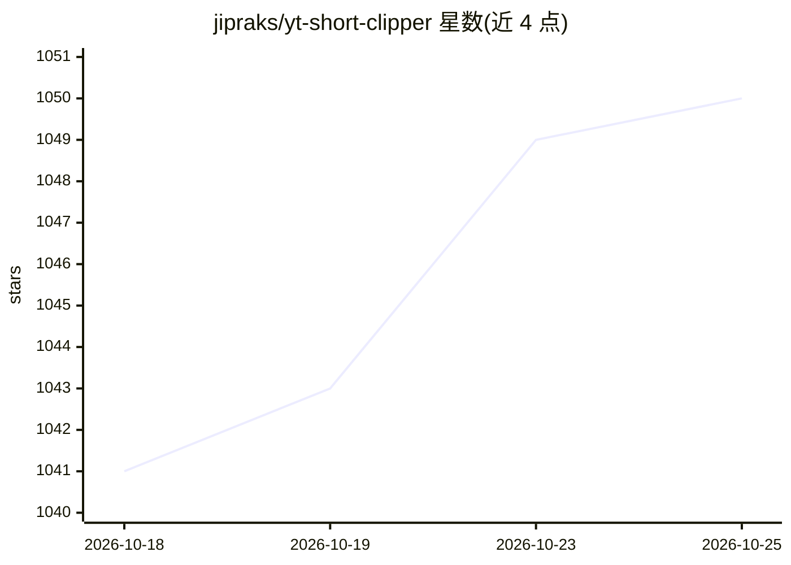

# jipraks/yt-short-clipper

⭐ 1,050 · TypeScript · MIT · 推送 2026-09-20 · [GitHub](https://github.com/jipraks/yt-short-clipper) · 个人维护

**把长视频转成 9:16 短片的 Windows 桌面应用：LLM 选高光**

面向短视频创作者的 Windows 桌面应用：粘贴 YouTube 链接并上传登录 cookies 后，由 yt-dlp 抓取视频与原字幕，LLM 读取字幕生成 58–120 秒高光片段，再经 FFmpeg 切割、竖屏重构（MediaPipe 面部跟踪或居中模式）并烧录逐字字幕输出 MP4。AI 通过 OpenAI 兼容端点接入，含内置钱包付费模式与自备 API key 两种方式。限制：仅 Windows、beta 状态、字幕来自原始字幕轨而非转写。

## 筛选速览

| 维度 | 判定 | 备注 |
|---|---|---|
| AI 角色 | `ai-native` | 本体是模型或模型工具 |
| 许可风险 | `permissive` | MIT |
| 部署形态 | `desktop` | 安装包/桌面程序 |
| 模型依赖 | local-ok | 支持本地模型 |
| 硬件要求 | — | 无带数字的原话,不猜 |
| 安装摩擦 | `medium` | 含编译或系统依赖之一 |
| 成熟度 | `idea` | |

## 能力要点

- LLM 从字幕中生成 58–120 秒高光片段，支持自由文本方向控制
- 三种竖屏重构模式：MediaPipe 面部跟踪/黑边居中/模糊填充
- 逐字字幕直接烧录自 YouTube 原字幕轨，无需转写 API 或本地 Whisper
- 内置钱包（QRIS 充值）或自备 OpenAI 兼容 API key 两种 AI 供给方式

## 适用场景

- 把长视频自动切成可发布的 Reels/Shorts 竖版短片
- 用自然语言指定想保留的时间段或主题生成片段
- 直接上传并定时发布剪辑到 Repliz 平台

## 场景标签

`图像视频处理` · 领域:感知与多模态

## 证据(README 行号)

> L3: A Windows desktop app that turns a long-form YouTube video into ready-to-post 9:16
> L21: 3. An LLM reads the transcript and proposes highlight segments (58–120s by default).
> L27: - **AI highlight detection** from the video's subtitle transcript, via any

## 星数曲线

2026-10-18 1,041 → 2026-10-25 1,050（+9）

---
*卡片 v1 · prompt 1.4 · 生成 2026-10-21 · 置信度 mid · 依据 README sha `227e860533a0` · [字段定义](../../DATASET.md)*
