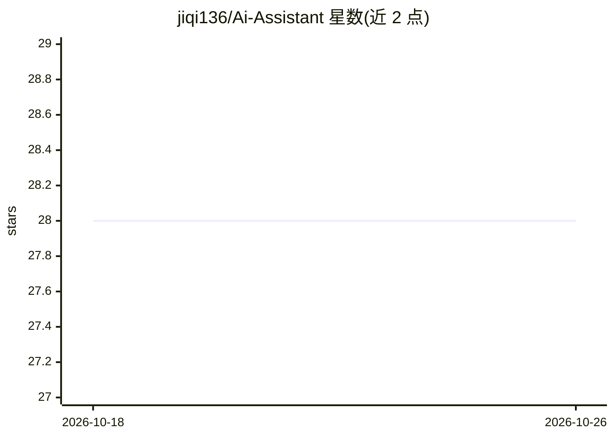

# jiqi136/Ai-Assistant

⭐ 28 · Go · Apache-2.0 · 推送 2026-06-08 · [GitHub](https://github.com/jiqi136/Ai-Assistant) · [官网](https://github.com/jiqi136/Ai-Assistant) · 个人维护 · 中文 README

**Windows 桌面 AI 助手：聚合国内外多家大模型做写作与编程**

绿色便携版 Windows 桌面应用，面向小说写作与 AI 编程场景：通过主流 API 中转接入 DeepSeek、Gemini、Claude、ChatGPT、Grok 等模型，支持 Nano Banana 图像生成、图片与 PDF 读取、多轮上下文管理、本地加密 SQLite 存储与历史搜索收藏。基于 Go + PC-Gui 框架构建，提供 releases 下载与双文件（main.go/go.mod）源码构建方式，兼容 Windows 7+ 系统。

## 筛选速览

| 维度 | 判定 | 备注 |
|---|---|---|
| AI 角色 | `ai-native` | 本体是模型或模型工具 |
| 许可风险 | `permissive` | Apache-2.0 |
| 部署形态 | `None` |  |
| 模型依赖 | locked-api |  |
| 硬件要求 | — | 无带数字的原话,不猜 |
| 安装摩擦 | `low` | 无编译、无系统依赖或容器化 |
| 成熟度 | — | 结构信号不足 |

## 能力要点

- 通过 API 中转接入 DeepSeek/Gemini/Claude/ChatGPT/Grok 等模型
- Nano Banana 图像生成与图片/PDF 多模态读取
- 多轮对话上下文管理（按轮删除、自定义注入文本）
- 本地加密 SQLite 存储，支持历史搜索与收藏分类

## 适用场景

- 在 Windows 旧系统（Win7+）上即开即用地使用多家大模型
- 写小说或编程时用 AI 辅助生成与多轮追问
- 把 AI 回答转为纯文本/HTML/BBCode 分享

## 场景标签

`AI 助手` `AI 写作` `图像生成` · 领域:对话与助手

## 证据(README 行号)

> L9: [Open Source] Novel Writing & AI Programming Assistant (V28.1) Green Portable Edition
> L21: |**Integrates World's Hottest AI Models**|Adapts to mainstream API route relays, using relayed models such as Gemin
> L24: |**Multi-Channel AI Engine**|Compatible with the latest DeepSeek versions v4-flash and v4-pro.|

## 星数曲线

2026-10-18 28 → 2026-10-26 28（+0）

---
*卡片 v1 · prompt 1.4 · 生成 2026-10-26 · 置信度 high · 依据 README sha `a3b8076d63ce` · [字段定义](../../DATASET.md)*
