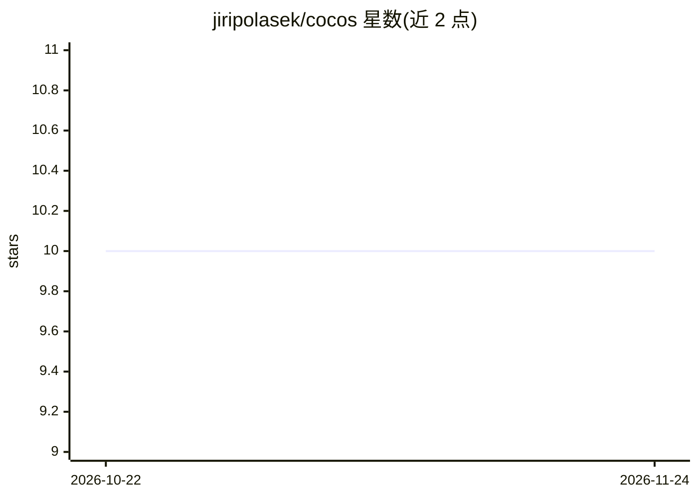

# jiripolasek/cocos

⭐ 10 · C# · Apache-2.0 · 推送 2026-02-10 · [GitHub](https://github.com/jiripolasek/cocos) · 个人维护

**给任意窗口附加 AI 陪伴助手的 Windows 桌面原型**

CoCos 是 Windows 上的早期原型应用，可为屏幕上任意应用召唤一个固定在窗口旁的 AI 陪伴助手。每个 CoCo 有独立外观，通过快捷键 Win+Shift+K 召唤，能识别所附着的应用并读取当前选区、输入或上下文（如文件管理器选中的文件、编辑器中高亮的文本）。提供聊天与便签双标签页，支持为不同 CoCo 配置不同模型（Ollama 本地或 ChatGPT API）。默认上下文不上云。需 Windows 10 (1809+) 与 .NET SDK，从源码构建运行。

## 筛选速览

| 维度 | 判定 | 备注 |
|---|---|---|
| AI 角色 | `ai-native` | 本体是模型或模型工具 |
| 许可风险 | `permissive` | Apache-2.0 |
| 部署形态 | `None` |  |
| 模型依赖 | local-ok | 支持本地模型 |
| 硬件要求 | — | 无带数字的原话,不猜 |
| 安装摩擦 | `medium` | 含编译或系统依赖之一 |
| 成熟度 | `idea` | |

## 能力要点

- 快捷键召唤附着到当前应用的 AI 陪伴窗口
- 感知附着应用上下文：选中文件、高亮文本
- 每个 CoCo 可独立配置模型（Ollama 或 ChatGPT）
- 聊天与便签双模式，默认数据不上传云端

## 适用场景

- 在任意应用内直接摘要文本或起草想法，无需切换 AI 应用
- 用本地 Ollama 模型在离线/隐私场景下获得上下文辅助
- 把不同 CoCo 绑定到不同应用，分别配置模型与用途

## 场景标签

`AI 助手` · 领域:对话与助手

## 证据(README 行号)

> L15: **CoCos** are personal AI companions that you can summon for any app on your screen. Each companion, or **"CoCo"**,
> L30: - **Bring Your Own Brain (AI Model)** — Power your CoCos with Ollama (for local, private use) or ChatGPT. You can e
> L49: **Requirements:** Windows 10 (1809+) or Windows 11, .NET SDK (net10.0), and either Ollama running locally or a Chat

## 星数曲线

2026-10-22 10 → 2026-11-24 10（+0）

---
*卡片 v1 · prompt 1.4 · 生成 2026-11-19 · 置信度 high · 依据 README sha `6f9812b9593e` · [字段定义](../../DATASET.md)*
