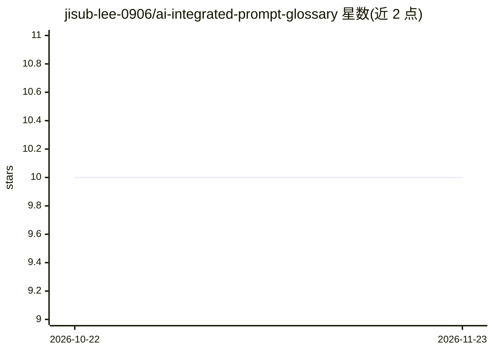

# jisub-lee-0906/ai-integrated-prompt-glossary

⭐ 10 · NOASSERTION · 推送 2026-10-21 · [GitHub](https://github.com/jisub-lee-0906/ai-integrated-prompt-glossary) · 个人维护

**面向设计·视频·开发者的 AI 指令韩语术语表**

一份韩语实务术语集：收录 240 个术语、24 章、203 页 PDF 与 12 份制作指令书，按设计/3D、视频·音频、开发·系统、制作交接四大领域组织。每个术语以统一框架提供定义、易混概念区分、执行指令、设置参数、验收标准与修改指令，用于组织 AI 任务指令与结果检核。提供网页文档与 PDF 阅读，无需安装应用；声明未对全部示例在所有模型上验证，也不保证模型行为。

## 筛选速览

| 维度 | 判定 | 备注 |
|---|---|---|
| AI 角色 | `ai-knowledge` | 知识聚合/清单类 |
| 许可风险 | `none` | NOASSERTION |
| 部署形态 | `None` |  |
| 模型依赖 | — | README 未给出锁定关系 |
| 硬件要求 | — | 无带数字的原话,不猜 |
| 安装摩擦 | `low` | 无编译、无系统依赖或容器化 |
| 成熟度 | — | 结构信号不足 |

## 能力要点

- 240 个术语覆盖设计·视频·开发三领域，配 12 份制作指令书
- 每个术语统一框架：定义/区分/执行指令/设置/验收/修改指令
- 48 个任务意图的术语查找入口与韩英索引
- 网页与 203 页 PDF 双形态，无需安装应用

## 适用场景

- 设计师生成 AI 设计稿时用准确术语描述修改需求
- 视频创作者向 AI 明确镜头、剪辑与交付条件
- 开发者向 AI 编码工具传达结构与验收标准
- 教育者讲解如何将需求转写为 AI 可执行的指令

## 场景标签

`提示工程` · 领域:Agent 开发

## 证据(README 行号)

> L3: 디자인·영상·개발 작업을 **정의 → 실행 명령 → 결과 검수 → 수정 요청**으로 설명하는 한국어 실무 용어집입니다. **240개 용어·24개 장·203쪽 PDF·제작 명령서 12개**를 웹 문서와 함께 제
> L91: Midjourney, Stable Diffusion, Runway, ChatGPT, Claude 등의 작업을 설명할 때 참고할 수 있습니다. 도구별 지원 기능과 실제 파일 속성은 별도로 확인해야 합니다. 모

## 星数曲线

2026-10-22 10 → 2026-11-23 10（+0）

---
*卡片 v1 · prompt 1.4 · 生成 2026-11-19 · 置信度 high · 依据 README sha `607d885756a6` · [字段定义](../../DATASET.md)*
