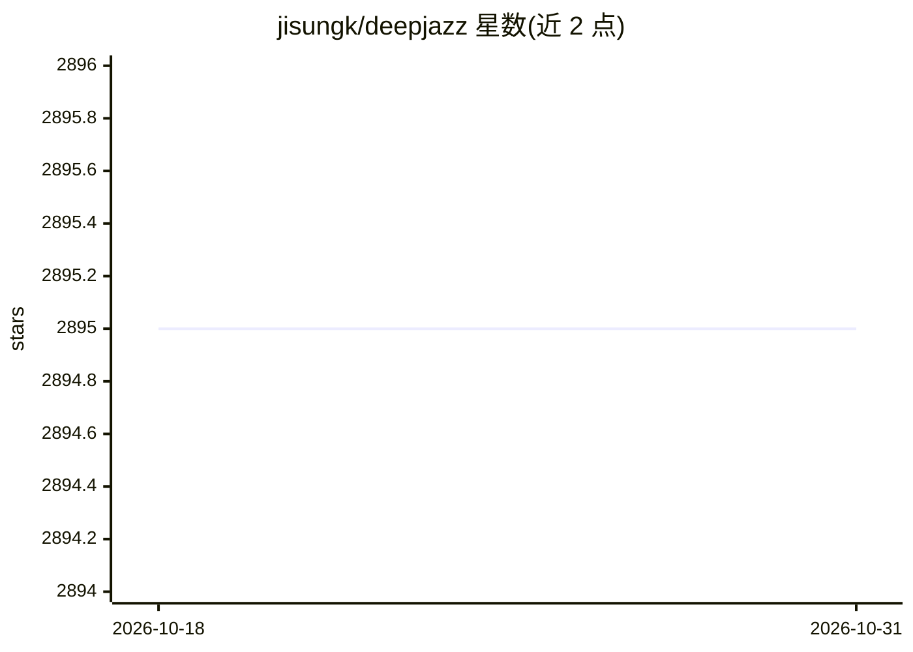

# jisungk/deepjazz

⭐ 2,895 · Python · Apache-2.0 · 推送 2026-03-19 · [GitHub](https://github.com/jisungk/deepjazz) · [官网](http://deepjazz.io) · 个人维护

**用 Keras/Theano LSTM 从 MIDI 学习并生成爵士乐的项目**

36 小时黑客松产出的音乐生成项目：基于 Keras 与 Theano 构建两层 LSTM，读取给定 MIDI 文件学习旋律并生成爵士乐，输出可试听（SoundCloud）。依赖 Keras、GitHub 版 Theano 与 music21，通过 python generator.py 在 CPU 或 GPU（NVIDIA CUDA）上运行。局限：需修改 preprocess.py 才能换用其他 MIDI 文件，且 README 声明项目已不再积极开发。

## 筛选速览

| 维度 | 判定 | 备注 |
|---|---|---|
| AI 角色 | `ai-native` | 本体是模型或模型工具 |
| 许可风险 | `permissive` | Apache-2.0 |
| 部署形态 | `None` |  |
| 模型依赖 | — | README 未给出锁定关系 |
| 硬件要求 | — | 无带数字的原话,不猜 |
| 安装摩擦 | `medium` | 含编译或系统依赖之一 |
| 成熟度 | `idea` | |

## 能力要点

- 两层 LSTM 从 MIDI 文件学习并生成爵士旋律
- 支持 CPU 与 GPU（NVIDIA CUDA 后端）两种运行方式
- 代码采用 Apache 2.0 许可

## 适用场景

- 用深度学习从 MIDI 生成爵士风格音乐
- 学习 LSTM 序列生成在音乐领域的应用方式

## 场景标签

 · 领域:AI 音乐生成

## 证据(README 行号)

> L7: I built *deepjazz* in 36 hours at a hackathon. It uses Keras & Theano, two deep learning libraries, to generate jazz
> L22: python generator.py [# of epochs]

## 星数曲线

2026-10-18 2,895 → 2026-10-31 2,895（+0）

---
*卡片 v1 · prompt 1.4 · 生成 2026-10-21 · 置信度 high · 依据 README sha `055fd494219c` · [字段定义](../../DATASET.md)*
