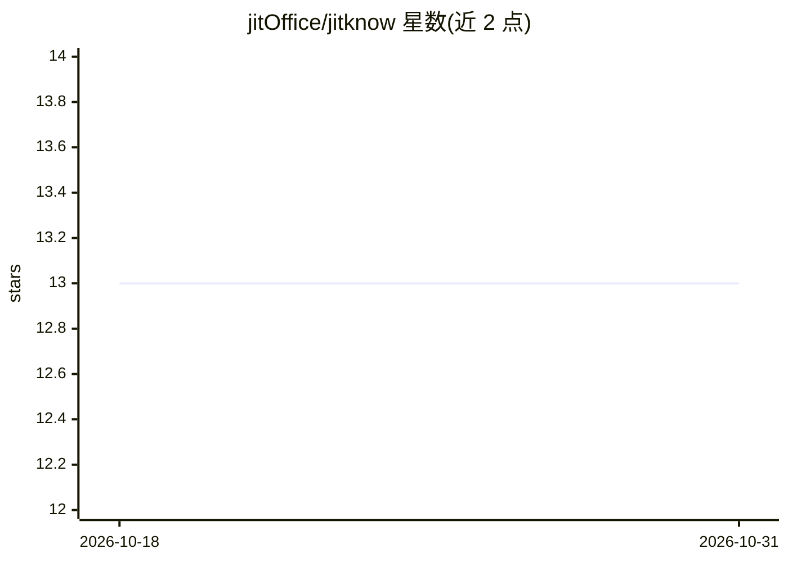

# jitOffice/jitknow

⭐ 13 · 推送 2026-04-26 · [GitHub](https://github.com/jitOffice/jitknow) · [官网](https://know.jitword.com) · 组织维护 · 中文 README

**企业级 AI 知识库平台的开放 API，供第三方嵌入问答能力**

JitKnow 是企业级 AI 智能知识库平台（SaaS，支持私有化部署），将 PDF、Word、Excel、网页等 20+ 格式文档构建为知识库，基于 RAG 实现问答。本仓库为其开放平台的开发者接入文档：提供 RESTful Chat API（SSE 流式、多轮对话 conversationId）、Citations 知识引用溯源、嵌入式 Widget（embed.js / iframe）、API Key 权限隔离、IP 白名单与 RPM/日配额限流。底层模型（GPT-4o、Claude、Gemini、Deepseek 等）在控制台配置，接入方无需改代码。

## 筛选速览

| 维度 | 判定 | 备注 |
|---|---|---|
| AI 角色 | `ai-native` | 本体是模型或模型工具 |
| 许可风险 | `none` | — |
| 部署形态 | `library` | 以包/库形式分发 |
| 模型依赖 | — | README 未给出锁定关系 |
| 硬件要求 | — | 无带数字的原话,不猜 |
| 安装摩擦 | `low` | 无编译、无系统依赖或容器化 |
| 成熟度 | — | 结构信号不足 |

## 能力要点

- SSE 流式对话 API，支持多轮对话上下文（后端维护最近 10 轮历史）
- Citations 引用溯源：回答标注文档名、页码与原文片段
- 嵌入式 Widget：悬浮气泡或 iframe，一行代码接入网页
- API Key 单助手绑定 + IP 白名单 + RPM/日配额限流的三层安全体系

## 适用场景

- 把产品手册 AI 助手嵌入官网，替代人工客服
- 在 OA、钉钉、飞书等内部系统集成 HR / 法务 / 技术文档问答
- 为自己的 SaaS 或移动端 App 添加 AI 知识库问答模块

## 场景标签

`文档问答` `知识库管理` · 领域:知识与检索

## 证据(README 行号)

> L28: JitKnow 是企业级 **AI 智能知识库平台**，支持将 PDF、Word、Excel、网页等 20+ 格式文档构建为专属 AI 知识库，通过 RAG（检索增强生成）技术实现精准问答。
> L30: **JitKnow 开放平台** 将这套 AI 能力以 API 形式开放给第三方开发者，典型应用场景包括：

## 星数曲线

2026-10-18 13 → 2026-10-31 13（+0）

---
*卡片 v1 · prompt 1.4 · 生成 2026-10-31 · 置信度 mid · 依据 README sha `82d8bb80dab6` · [字段定义](../../DATASET.md)*
