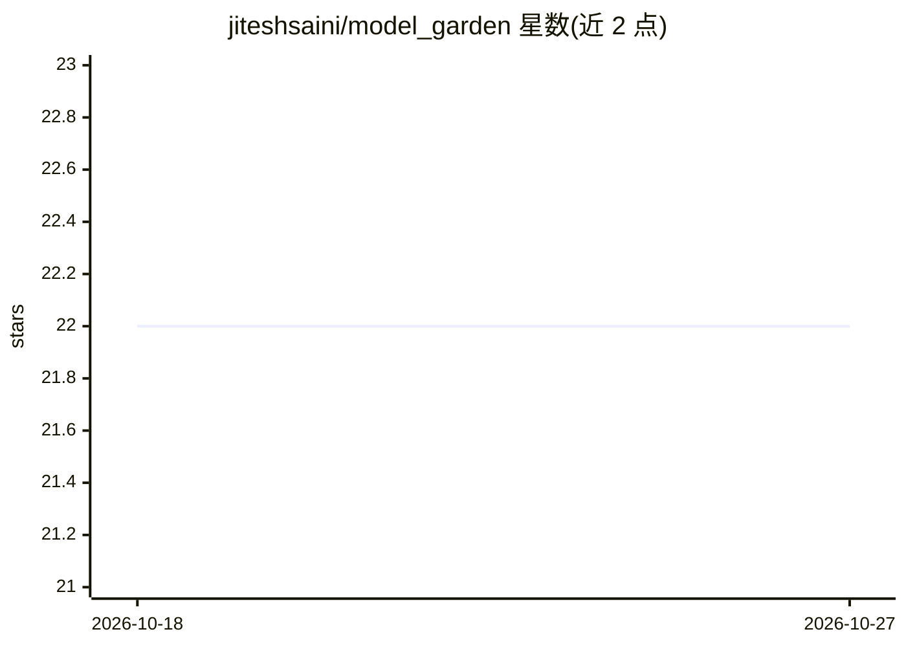

# jiteshsaini/model_garden

⭐ 22 · Python · 推送 2026-09-15 · [GitHub](https://github.com/jiteshsaini/model_garden) · 个人维护

**树莓派上实时对比测试视觉模型的教育工具**

在 Raspberry Pi 摄像头实时画面上运行 Google 预训练视觉模型的教育工具：含 9 个图像分类与 3 个目标检测模型，每个均有 CPU 版与 Coral USB Accelerator 的 Edge TPU 编译版。网页可在运行中切换模型，直接比较各模型的输出、置信度与推理速度；插入 Coral 后可一键切换 _edgetpu 版本。提供一键安装脚本（更新系统、装依赖、下载 185MB 模型），并给出 Pi 3A+ 与 Pi 4 的实测推理耗时表。已适配最新 Raspberry Pi OS（Trixie）。

## 筛选速览

| 维度 | 判定 | 备注 |
|---|---|---|
| AI 角色 | `ai-native` | 本体是模型或模型工具 |
| 许可风险 | `none` | — |
| 部署形态 | `library` | 以包/库形式分发 |
| 模型依赖 | — | README 未给出锁定关系 |
| 硬件要求 | — | 无带数字的原话,不猜 |
| 安装摩擦 | `low` | 无编译、无系统依赖或容器化 |
| 成熟度 | — | 结构信号不足 |

## 能力要点

- 12 个 Google 预训练视觉模型，网页运行中热切换对比
- 每个模型提供 CPU 版与 Coral Edge TPU 编译版
- 一键安装脚本（下载 185MB 模型，旧版自动备份）
- Pi 3A+/Pi 4 的 CPU 与 Coral 推理耗时实测数据

## 适用场景

- 在树莓派上直观比较不同视觉模型的准确性与速度
- 评估 Coral USB Accelerator 对边缘推理的加速效果
- 学习边缘设备上 TensorFlow Lite 模型的部署方式

## 场景标签

`目标检测` `模型评测` · 领域:评测与运维

## 证据(README 行号)

> L15: Model Garden is an educational tool for understanding how machine learning models behave. It runs a model on a live
> L17: The models are pre-trained computer-vision models published by Google, packaged as canned models at https://dl.goog

## 星数曲线

2026-10-18 22 → 2026-10-27 22（+0）

---
*卡片 v1 · prompt 1.4 · 生成 2026-10-27 · 置信度 mid · 依据 README sha `7505808c448b` · [字段定义](../../DATASET.md)*
