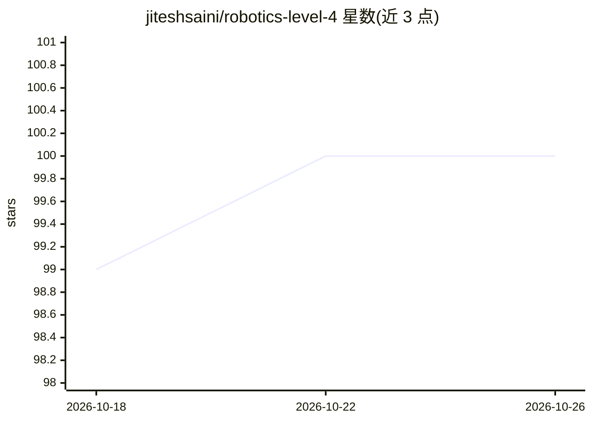

# jiteshsaini/robotics-level-4

⭐ 100 · Python · 推送 2026-09-20 · [GitHub](https://github.com/jiteshsaini/robotics-level-4) · [官网](https://helloworld.co.in/) · 个人维护

**树莓派机器人在板机器学习：检测、追踪、人跟随与手势识别**

Earth Rover 系列第 4 级项目：在树莓派上本机运行 TensorFlow Lite 模型处理摄像头画面，无云端依赖，模型输出直接驱动电机。提供五个 ML 项目：目标检测报警、目标跟踪、人体跟随、图像分类（带语音播报）和 Teachable Machine 手势控制。通过单页控制面板操作，安装为一条 curl+bash 脚本（装 Apache/PHP/TFLite 运行时/OpenCV 等），可选 Coral USB 加速器（运行时自动检测，无则跑 CPU；512MB 板需关闭桌面）。已在 Pi 3A+ 与 Pi 4（Raspberry Pi OS Trixie）测试。

## 筛选速览

| 维度 | 判定 | 备注 |
|---|---|---|
| AI 角色 | `ai-native` | 本体是模型或模型工具 |
| 许可风险 | `none` | — |
| 部署形态 | `None` |  |
| 模型依赖 | — | README 未给出锁定关系 |
| 硬件要求 | — | 无带数字的原话,不猜 |
| 安装摩擦 | `low` | 无编译、无系统依赖或容器化 |
| 成熟度 | — | 结构信号不足 |

## 能力要点

- 五个 ML 项目：检测/跟踪/人跟随/分类/Teachable Machine 手势
- 模型在 Pi 本机运行，无云端与网络往返
- Coral USB 加速器运行时自动检测，无则 CPU 运行
- 一键安装脚本含完整依赖部署与自检/验证模式

## 适用场景

- 搭建一台能识别人与物体并跟随移动的树莓派小车
- 用 Teachable Machine 自训手势模型控制机器人
- 在浏览器中实时查看机器人摄像头并远程操控

## 场景标签

`目标检测` · 领域:感知与多模态

## 证据(README 行号)

> L13: this level runs **machine learning on the robot itself**. The camera feed is
> L34: |**Object Detection**|Watches for one chosen object and raises an alarm on the control panel when it appears|

## 星数曲线

2026-10-18 99 → 2026-10-26 100（+1）

---
*卡片 v1 · prompt 1.4 · 生成 2026-10-23 · 置信度 high · 依据 README sha `003bcbfc7642` · [字段定义](../../DATASET.md)*
