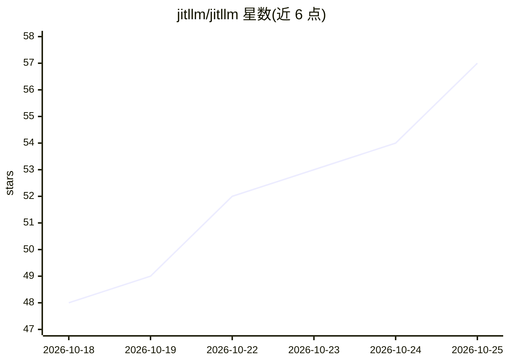

# jitllm/jitllm

⭐ 57 · Go · Apache-2.0 · 推送 2026-10-24 · [GitHub](https://github.com/jitllm/jitllm) · [官网](http://jitllm.org/) · 个人维护

**自适应硬件的 LLM 推理引擎：单二进制运行超内存大模型**

面向 LLM 推理的运行时引擎，以单个自包含二进制分发 CLI、服务器 jitllmd、桌面应用与终端应用。机制：加载时按模型形状与权重格式为当前机器生成 JIT 内核（x86/Arm CPU、CUDA PTX、Vulkan SPIR-V、Metal、AMDGPU）；磁盘/RAM/VRAM 统一为分页层级，超过内存的模型按需从磁盘分页；层与 KV 缓存可在对话中途跨设备迁移。服务器提供 OpenAI/Anthropic 兼容 API、工具调用、结构化输出、连续批处理与 Prometheus 指标。转换支持 65 种 GGUF 架构名与 30 个 Hugging Face 类，ROCm 后端未经 AMD 硬件测试。

## 筛选速览

| 维度 | 判定 | 备注 |
|---|---|---|
| AI 角色 | `ai-ecosystem` | LLM/agent 周边工具 |
| 许可风险 | `permissive` | Apache-2.0 |
| 部署形态 | `desktop` | 安装包/桌面程序 |
| 模型依赖 | local-ok | 支持本地模型 |
| 硬件要求 | — | 无带数字的原话,不猜 |
| 安装摩擦 | `low` | 无编译、无系统依赖或容器化 |
| 成熟度 | — | 结构信号不足 |

## 能力要点

- 为当前硬件 JIT 生成内核（CPU SIMD、CUDA、Vulkan、Metal、AMDGPU）
- 磁盘/RAM/VRAM 统一分页，超过内存的模型可运行
- 层与 KV 缓存可对话中途在 CPU/GPU 间迁移
- 服务器提供 OpenAI/Anthropic 兼容 API、24 族工具调用格式与连续批处理

## 适用场景

- 在显存/内存不足的机器上运行大参数模型
- 本机或服务器部署多模型多会话的 OpenAI 兼容推理服务
- 实时查看并调整模型各层在 CPU 与 GPU 间的放置

## 场景标签

`推理引擎` · 领域:训练与推理

## 证据(README 行号)

> L54: That's why I call it an operating system for LLM inference. It detects your CPUs
> L88: One binary, `jitllmd`, many models and many sessions at once:

## 星数曲线

2026-10-18 48 → 2026-10-25 57（+9）

---
*卡片 v1 · prompt 1.4 · 生成 2026-10-24 · 置信度 high · 依据 README sha `3b86f8a0f347` · [字段定义](../../DATASET.md)*
