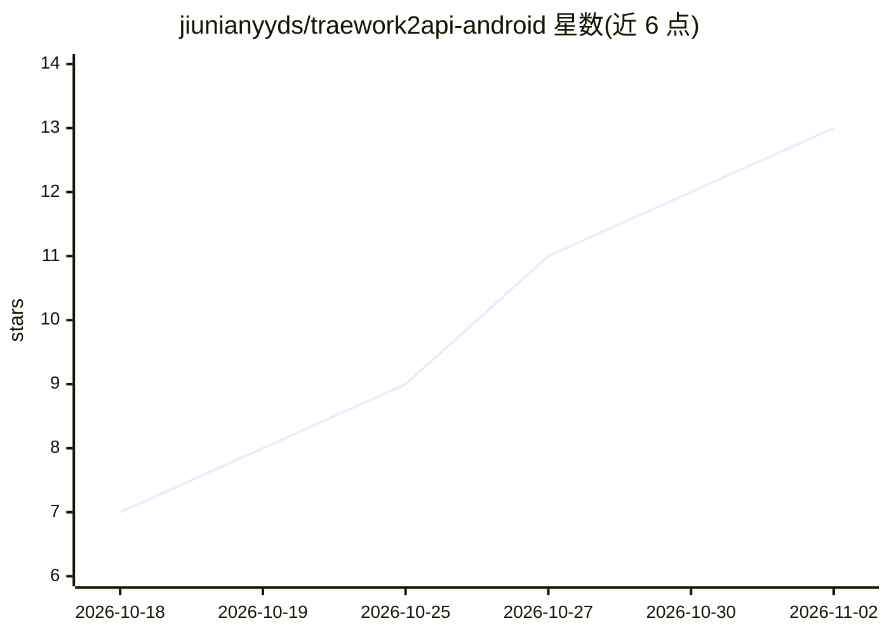

# jiunianyyds/traework2api-android

⭐ 13 · Kotlin · MIT · 推送 2026-10-23 · [GitHub](https://github.com/jiunianyyds/traework2api-android) · 个人维护 · 中文 README

**Android 本地 API 网关：把 Trae 账号额度转为 OpenAI 兼容 API**

纯 Kotlin 实现的 Android 本地 API 网关：将用户的 Trae（国内版 trae.cn）账号额度暴露为 OpenAI 兼容接口（/v1/chat/completions 流式/非流式/工具调用、/v1/models），手机/同 WiFi 设备上的 Chatbox、沉浸式翻译、OpenAI SDK 等客户端均可连接。支持多账号保存与自动换号、token 自动续期、每日签到与积分监测、账号 JSON 备份导入导出、前台服务保活。以 APK 形式分发，也可用 JDK 17+ 与 Android SDK 自行编译；README 声明仅供个人学习研究，与 Trae 官方无关。

## 筛选速览

| 维度 | 判定 | 备注 |
|---|---|---|
| AI 角色 | `ai-ecosystem` | LLM/agent 周边工具 |
| 许可风险 | `permissive` | MIT |
| 部署形态 | `None` |  |
| 模型依赖 | — | README 未给出锁定关系 |
| 硬件要求 | — | 无带数字的原话,不猜 |
| 安装摩擦 | `medium` | 含编译或系统依赖之一 |
| 成熟度 | — | 结构信号不足 |

## 能力要点

- OpenAI 兼容 /v1/chat/completions（流式 SSE/非流式/工具调用）与 /v1/models
- 多账号管理：token 失效/限流自动换号，积分低于阈值自动切换余额最多账号
- refresh token 轮换续期与全部账号定时签到（含补签）
- 前台服务 + 唤醒锁 + 看门狗闹钟保活，监听 0.0.0.0 供局域网设备连接

## 适用场景

- 让手机上的 Chatbox、沉浸式翻译等客户端直接使用自己的 Trae 账号额度
- 同一 WiFi 下让电脑上的 OpenAI 兼容客户端连接手机上的网关
- 管理多个 Trae 账号并自动签到、监测积分

## 场景标签

`模型网关` · 领域:Agent 开发

## 证据(README 行号)

> L11: 一个跑在 Android 手机上的本地 API 网关。启动后，你手机/电脑上的其它 App（Chatbox、
> L26: - **OpenAI 兼容**：`/v1/chat/completions`（流式 SSE / 非流式 JSON / 工具调用）、`/v1/models`、`/healthz`

## 星数曲线

2026-10-18 7 → 2026-11-02 13（+6）

---
*卡片 v1 · prompt 1.4 · 生成 2026-11-01 · 置信度 high · 依据 README sha `bb66f59e27b4` · [字段定义](../../DATASET.md)*
