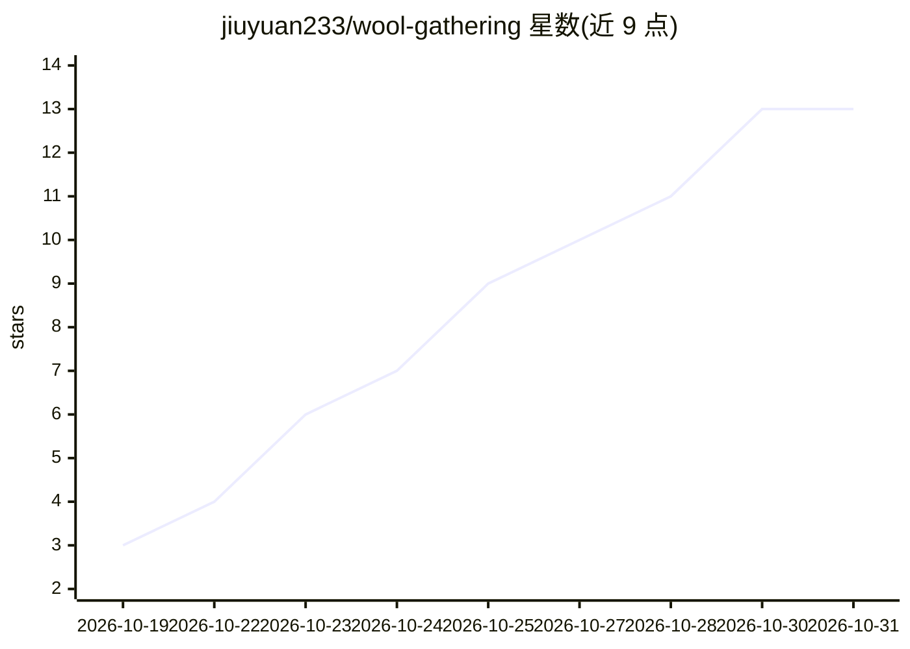

# jiuyuan233/wool-gathering

⭐ 13 · Python · MIT · 推送 2026-10-30 · [GitHub](https://github.com/jiuyuan233/wool-gathering) · 个人维护 · 中文 README

**AI/游戏免费福利活动自动收集情报站，每日更新**

由 GitHub Actions 与 AI 每日自动更新的免费福利聚合项目：抓取小黑盒等来源的 AI 免费额度、云厂商代金券、GPU 算力、Epic/Steam 限免等活动，生成活动时间轴（SVG 日历可嵌入 README）与分类详情；支持 fork 后使用、通过 PENDING_URLS.md 提交 URL 由 AI 自动完成抓取与规范化入库。README 同时收录社区维护的免费 LLM API、云服务免费层、创业信用额度等资源清单，以及支持 BYOK 的网页 Agent 工具对照表。免责声明指出仅收集公开信息、AI 抽取可能有误。

## 筛选速览

| 维度 | 判定 | 备注 |
|---|---|---|
| AI 角色 | `ai-knowledge` | 知识聚合/清单类 |
| 许可风险 | `permissive` | MIT |
| 部署形态 | `None` |  |
| 模型依赖 | — | README 未给出锁定关系 |
| 硬件要求 | — | 无带数字的原话,不猜 |
| 安装摩擦 | `low` | 无编译、无系统依赖或容器化 |
| 成熟度 | — | 结构信号不足 |

## 能力要点

- GitHub Actions + AI 每日自动更新活动时间轴与今日概况
- PENDING_URLS.md 提交 URL 即可由 AI 完成抓取→规范化→进日历
- 小黑盒社区 8 个分区自动分类抓取
- SVG 日历嵌入 README，fork 即可使用

## 适用场景

- 每天查看各厂商大模型免费额度与代金券活动
- 追踪 Epic/Steam 限免游戏信息
- fork 仓库后自动维护自己的福利情报日历
- 查找社区整理的免费 LLM API 与云服务免费层清单

## 场景标签

`精选清单` · 领域:学习与行业

## 证据(README 行号)

> L3: > 全网 **AI / 游戏** 免费福利活动自动收集 · 每日由 GitHub Actions + AI 更新
> L60: - 更新时间：**2026-10-31 00:49** 北京时间
> L65: > **PENDING_URLS.md 自动抓取**：在 `PENDING_URLS.md` 写 URL，AI 全自动完成添加源 → 抓取内容 → 规范化 → 进日历。用户只需提交 URL，不用做任何规范化。

## 星数曲线

2026-10-19 3 → 2026-10-31 13（+10）

---
*卡片 v1 · prompt 1.4 · 生成 2026-10-31 · 置信度 high · 依据 README sha `dc267884d12b` · [字段定义](../../DATASET.md)*
