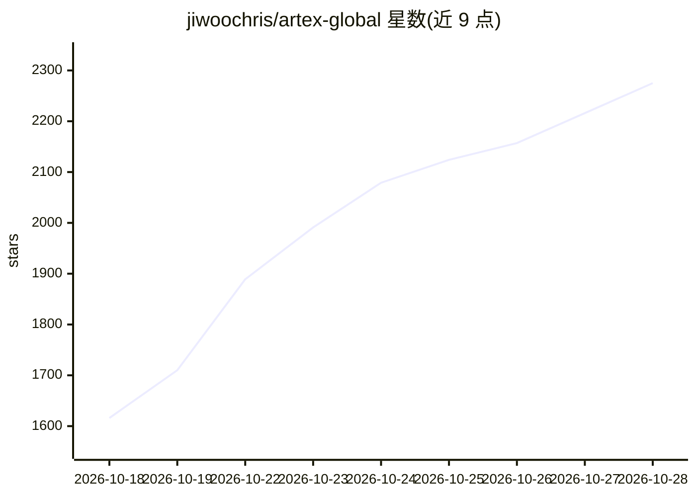

# jiwoochris/artex-global

⭐ 2,275 · Go · AGPL-3.0 · 推送 2026-10-14 · [GitHub](https://github.com/jiwoochris/artex-global) · 个人维护 · 中文 README

**多语言本地化版 ARTEX：LLM 多智能体自主渗透测试系统**

Autumn-27/ARTEX 的本地化分叉版：多个 LLM 驱动的智能体自主执行渗透测试，自行拆解目标、调用真实工具（nmap 等），将发现的资产与漏洞积累进图结构；含 Next.js 前端（嵌入单个 Go 二进制）、PostgreSQL 存储、人在回路聊天与按严重度汇总的发现列表。此版将面向用户的输出强制切换为英/韩/中/西/日五种语言，智能体内部推理提示保留原语言。README 限定仅用于授权环境，并附检测签名与加固清单等防御材料；上游据报曾被用于韩国金融机构数据泄露事件的调查。Docker Compose 或源码编译安装。

## 筛选速览

| 维度 | 判定 | 备注 |
|---|---|---|
| AI 角色 | `ai-native` | 本体是模型或模型工具 |
| 许可风险 | `viral` | AGPL-3.0 |
| 部署形态 | `self-host` | docker 或自建部署 |
| 模型依赖 | locked-api |  |
| 硬件要求 | — | 无带数字的原话,不猜 |
| 安装摩擦 | `low` | 无编译、无系统依赖或容器化 |
| 成熟度 | — | 结构信号不足 |

## 能力要点

- 多个 LLM 智能体自主完成侦察到利用的完整渗透流程，结果累积为资产/漏洞图
- 面向用户输出可切换英/韩/中/西/日五种语言，内部推理提示保留原语言
- 单 Go 二进制内嵌 Next.js 前端，数据存 PostgreSQL
- 附检测签名与加固清单等面向防御者的材料

## 适用场景

- 在本地隔离靶场（如 DVWA、Juice Shop）中学习自主 AI 攻击的运作方式
- 授权渗透测试中让多智能体自动执行侦察与漏洞验证
- 安全团队构建针对自主 AI 攻击的检测与加固能力

## 场景标签

`多智能体` `网络安全` · 领域:Agent 开发

## 证据(README 行号)

> L3: **An autonomous penetration-testing system driven by LLM multi-agents** (Go backend + Next.js frontend)
> L25: ARTEX is a system in which several LLM-driven agents autonomously run a penetration test: they **break goals down o

## 星数曲线

2026-10-18 1,616 → 2026-10-28 2,275（+659）

---
*卡片 v1 · prompt 1.4 · 生成 2026-10-21 · 置信度 high · 依据 README sha `e3f5ebed9aa2` · [字段定义](../../DATASET.md)*
