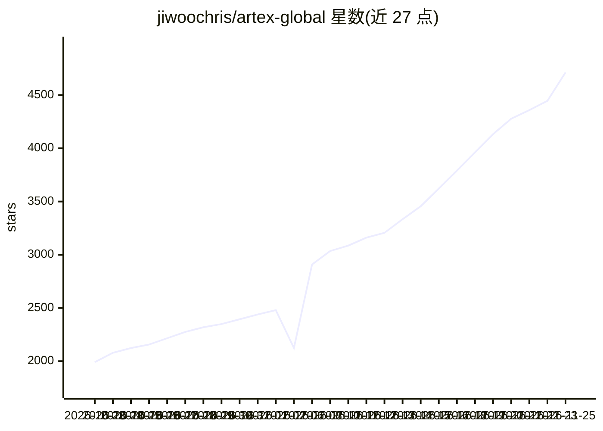

# jiwoochris/artex-global

⭐ 4,713 · Go · AGPL-3.0 · 推送 2026-11-19 · [GitHub](https://github.com/jiwoochris/artex-global) · 个人维护 · 中文 README

**LLM 多智能体自主渗透测试框架的多语言全球化版本**

ARTEX 全球版是上游中文项目 Autumn-27/ARTEX（AGPL-3.0）的本地化分支，由多个 LLM 驱动的 agent 自主执行渗透测试：自行分解目标、执行真实工具、将资产与漏洞积累到图中；Go 后端将 Next.js 前端嵌入单一二进制，数据存 PostgreSQL。本版将用户可见输出（发现项、报告、摘要、聊天）强制为所选语言（默认英文，可切换韩/中/西/日），内部推理 prompt 保留原语言以维持基准性能。仅限授权环境与防御/检测用途，README 明确记载上游被韩国媒体报道涉入金融机构数据泄露案件的调查。

## 筛选速览

| 维度 | 判定 | 备注 |
|---|---|---|
| AI 角色 | `ai-native` | 本体是模型或模型工具 |
| 许可风险 | `viral` | AGPL-3.0 |
| 部署形态 | `self-host` | docker 或自建部署 |
| 模型依赖 | locked-api |  |
| 硬件要求 | — | 无带数字的原话,不猜 |
| 安装摩擦 | `low` | 无编译、无系统依赖或容器化 |
| 成熟度 | — | 结构信号不足 |

## 能力要点

- LLM 多 agent 自主渗透测试：目标分解、真实工具执行、资产/漏洞图谱积累
- 五语言输出切换（英/韩/中/西/日），内部推理 prompt 不翻译以保留性能
- Docker Compose 一键部署 + 单二进制源码构建（前端嵌入）
- human-in-the-loop 聊天可中途注入提示，发现项可按严重度导出 CSV

## 适用场景

- 在自有隔离环境中学习自主 AI 攻击的工作方式
- 为蓝队构建针对自主 AI 攻击的检测签名与加固清单
- 对自有目标做授权范围内的渗透验证并生成多语言报告

## 场景标签

`多智能体` `网络安全` · 领域:Agent 开发

## 证据(README 行号)

> L3: **An autonomous penetration-testing system driven by LLM multi-agents** (Go backend + Next.js frontend)
> L25: ARTEX is a system in which several LLM-driven agents autonomously run a penetration test: they **break goals down o

## 星数曲线

2026-10-23 1,991 → 2026-11-25 4,713（+2,722）

---
*卡片 v1 · prompt 1.4 · 生成 2026-11-22 · 置信度 high · 依据 README sha `1e28518c70c7` · [字段定义](../../DATASET.md)*
