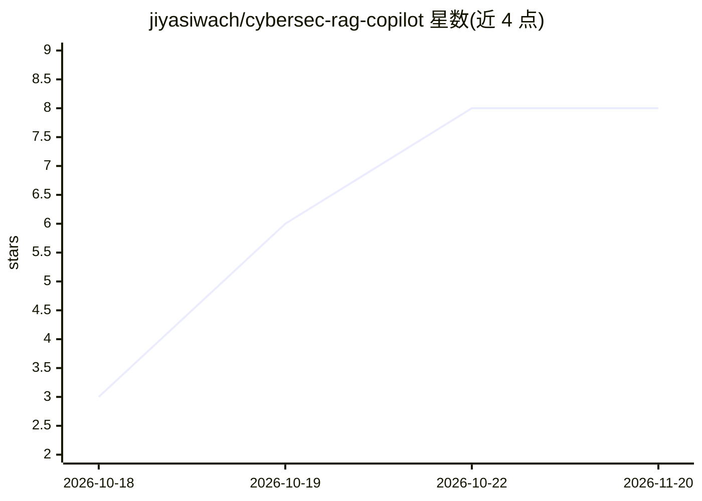

# jiyasiwach/cybersec-rag-copilot

⭐ 8 · Python · 推送 2026-10-14 · [GitHub](https://github.com/jiyasiwach/cybersec-rag-copilot) · [官网](https://cybersec-rag-copilot-tan.vercel.app) · 个人维护

**仅基于安全知识库回答的 RAG 问答助手，带引用与评测**

面向网络安全从业者的聊天助手，知识库限定为 MITRE ATT&CK、OWASP Top 10 (2021) 与 CISA KEV，共 948 个 chunk。检索采用 ChromaDB 向量搜索与 BM25 关键词搜索的 RRF 融合，并支持按请求切换检索模式；每条事实声明附带可点击的 [n] 引用，指向检索片段及原始来源。检索前设有两层 prompt 注入防护（正则启发式 + LLM 分类器），内置评测面板输出 Hit@5、MRR、忠实度与引用准确率。后端 FastAPI，前端 React，提供 Docker 部署。

## 筛选速览

| 维度 | 判定 | 备注 |
|---|---|---|
| AI 角色 | `ai-native` | 本体是模型或模型工具 |
| 许可风险 | `none` | — |
| 部署形态 | `self-host` | docker 或自建部署 |
| 模型依赖 | — | README 未给出锁定关系 |
| 硬件要求 | — | 无带数字的原话,不猜 |
| 安装摩擦 | `low` | 无编译、无系统依赖或容器化 |
| 成熟度 | — | 结构信号不足 |

## 能力要点

- 混合检索：向量 + BM25 经 RRF 融合，模式可按请求切换（hybrid | vector | bm25）
- 每条回答附带 [n] 引用，可点击查看检索片段与原始来源
- 两层 prompt 注入防护：正则启发式 + 小型 LLM 分类器
- 内置评测：Hit@5、MRR、LLM 评审忠实度、防护误报率

## 适用场景

- 查询 ATT&CK 技术与 CVE 详情并获得带出处引用的回答
- 检测并拦截针对问答系统的 prompt 注入尝试
- 对比不同检索模式在安全知识问答上的评测指标

## 场景标签

`RAG` `网络安全` `模型评测` · 领域:评测与运维

## 证据(README 行号)

> L3: **A cybersecurity chat assistant that answers only from a curated knowledge base — MITRE ATT&CK, OWASP Top 10 (2021)
> L12: - **Hybrid retrieval.** Vector search (ChromaDB, cosine) + BM25 keyword search fused with Reciprocal Rank Fusion, p
> L13: - **Guardrail before retrieval.** Free regex heuristics block obvious injections; ambiguous inputs go to a small LL

## 星数曲线

2026-10-18 3 → 2026-11-20 8（+5）

---
*卡片 v1 · prompt 1.4 · 生成 2026-11-20 · 置信度 high · 依据 README sha `080f5bd3af76` · [字段定义](../../DATASET.md)*
