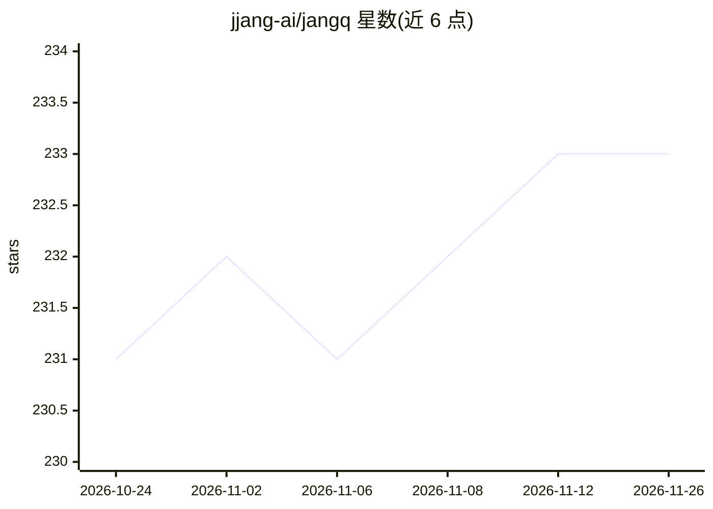

# jjang-ai/jangq

⭐ 233 · Python · 推送 2026-11-22 · [GitHub](https://github.com/jjang-ai/jangq) · [官网](https://jangq.ai/) · 个人维护

**Apple Silicon 上的 MLX 混合精度量化格式与运行时**

JANG（J-Adaptive N-bit Grading）为 MLX 提供混合精度量化格式与配套运行时，面向 Apple Silicon（Metal）本地推理。核心机制为按张量分配位宽（注意力 8-bit、专家 2-bit），支持 bfloat16 自动检测以避免 float16 溢出，提供 JANG_1L 至 4K 等量化档位与预量化模型集合。提供 pip 安装的 Python 包、jang convert 转换命令、推理 loader、MMLU 基准脚本，以及 JANG Studio 转换向导（签名 DMG）。限制：LM Studio、Ollama 等应用尚不支持该格式。

## 筛选速览

| 维度 | 判定 | 备注 |
|---|---|---|
| AI 角色 | `ai-ecosystem` | LLM/agent 周边工具 |
| 许可风险 | `none` | — |
| 部署形态 | `library` | 以包/库形式分发 |
| 模型依赖 | — | README 未给出锁定关系 |
| 硬件要求 | — | 无带数字的原话,不猜 |
| 安装摩擦 | `low` | 无编译、无系统依赖或容器化 |
| 成熟度 | — | 结构信号不足 |

## 能力要点

- 混合精度量化：注意力 8-bit、专家 2-bit 的按张量位宽分配
- bfloat16 自动检测，支持 512 专家模型的低比特量化
- JangPress 内存策略：mmap + 路由感知驱逐，加载超过 RAM 的 routed-MoE 模型
- 提供 JANG Studio 转换向导（五步流程、签名 DMG）与推理/基准 CLI

## 适用场景

- 在 Mac 上以更低内存占用运行大参数 MoE 模型
- 将 HuggingFace 模型转换为 JANG/JANGTQ 格式并发布
- 对本地量化模型运行 MMLU 基准与推理模式对比

## 场景标签

`模型量化` `推理引擎` · 领域:训练与推理

## 证据(README 行号)

> L18:  Mixed-Precision Quantization for Apple Silicon
> L20:  The GGUF equivalent for MLX — models stay quantized in GPU memory at full Metal speed.

## 星数曲线

2026-10-24 231 → 2026-11-26 233（+2）

---
*卡片 v1 · prompt 1.4 · 生成 2026-11-25 · 置信度 high · 依据 README sha `92799f1b0166` · [字段定义](../../DATASET.md)*
