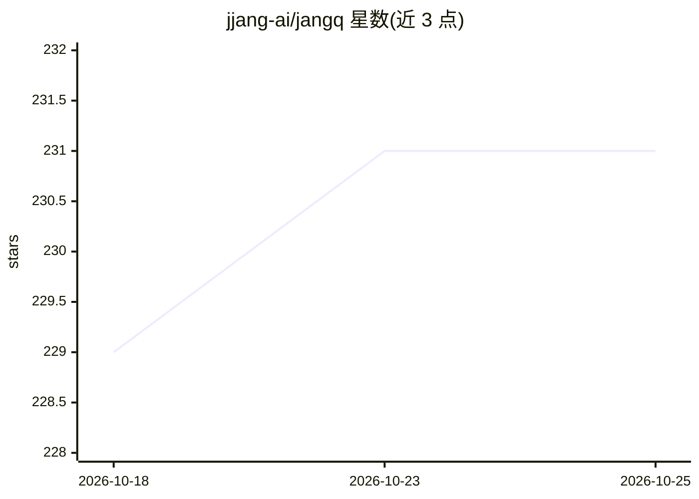

# jjang-ai/jangq

⭐ 231 · Python · 推送 2026-10-25 · [GitHub](https://github.com/jjang-ai/jangq) · [官网](https://jangq.ai/) · 个人维护

**面向 Apple Silicon 的 MLX 混合精度量化格式与推理运行时**

JANG 提供一套 MLX 之上的自适应混合精度量化格式（JANG_1L 至 JANG_4K 等档位，注意力层高比特、专家层低比特）及配套 Python 工具与推理运行时，供 Apple Silicon 用户在有限内存下加载与运行大模型。核心机制：bfloat16 自动检测、DeepSeek-V4-Flash 三种混合注意力层的运行路径、JangPress mmap 冷层换出以加载超过内存的 MoE 模型。以 pip 包发布，支持 VLM 与多类架构；README 声称需配合 jang[mlx] 运行时使用，App 支持范围以 MLX Studio、oMLX 为限。

## 筛选速览

| 维度 | 判定 | 备注 |
|---|---|---|
| AI 角色 | `ai-ecosystem` | LLM/agent 周边工具 |
| 许可风险 | `none` | — |
| 部署形态 | `library` | 以包/库形式分发 |
| 模型依赖 | locked-api |  |
| 硬件要求 | — | 无带数字的原话,不猜 |
| 安装摩擦 | `low` | 无编译、无系统依赖或容器化 |
| 成熟度 | — | 结构信号不足 |

## 能力要点

- 混合精度档位体系（1L~4K），注意力高比特、专家低比特的差异化分配
- DeepSeek-V4-Flash 的 SWA+CSA+HSA 混合注意力运行时与 mHC 残差处理
- JangPress：mmap+madvise 冷层换出，在 128GB Mac 上加载 167GB MoE 模型
- 提供 200 题 MMLU 基准脚本（两轮思考重试、断点续跑）

## 适用场景

- 在 16-128GB 内存的 Mac 上运行超大规模 MoE 或稠密模型
- 把 HuggingFace 模型转换为 JANG/JANGTQ 格式并量化到 2-bit
- 为 MLX 应用添加 JANG 模型加载支持（附 INTEGRATION.md 集成指南）

## 场景标签

`模型量化` `推理引擎` · 领域:训练与推理

## 证据(README 行号)

> L18:  Mixed-Precision Quantization for Apple Silicon
> L20:  The GGUF equivalent for MLX — models stay quantized in GPU memory at full Metal speed.
> L200: pip install "jang[mlx]>=2.5.18"

## 星数曲线

2026-10-18 229 → 2026-10-25 231（+2）

---
*卡片 v1 · prompt 1.4 · 生成 2026-10-22 · 置信度 high · 依据 README sha `6a688de4d8db` · [字段定义](../../DATASET.md)*
