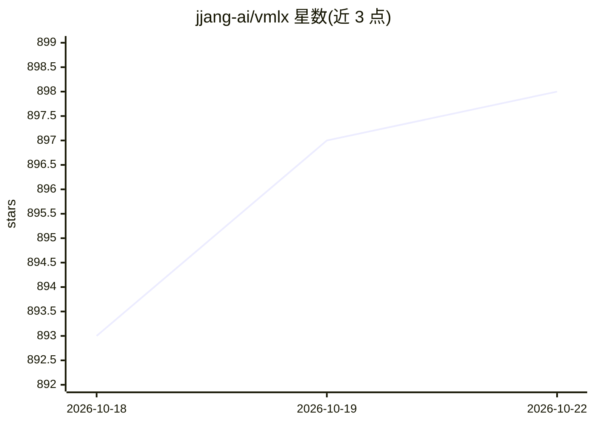

# jjang-ai/vmlx

⭐ 899 · Python · Apache-2.0 · 推送 2026-10-21 · [GitHub](https://github.com/jjang-ai/vmlx) · [官网](https://vmlx.net) · 个人维护

**Apple Silicon 本地推理服务器：运行 MLX 模型并兼容多 API**

面向 Apple Silicon Mac 的自托管推理服务器，运行 MLX 格式的文本 LLM、视觉 LLM、MoE、混合 SSM、图像生成（Flux via mflux）、嵌入/重排与音频（Kokoro TTS / Whisper STT）模型。提供 OpenAI、Anthropic 与 Ollama 兼容 HTTP API，无需第三方 API key。特性含连续批处理、分页 KV 缓存与量化、投机解码、SSD 持久化缓存，以及跨多台 Mac 的流水线并行分布式推理。以 PyPI 包 vmlx 安装，另提供 MLX Studio 原生 macOS 桌面应用（DMG）。

## 筛选速览

| 维度 | 判定 | 备注 |
|---|---|---|
| AI 角色 | `ai-ecosystem` | LLM/agent 周边工具 |
| 许可风险 | `permissive` | Apache-2.0 |
| 部署形态 | `library` | 以包/库形式分发 |
| 模型依赖 | local-ok | 支持本地模型 |
| 硬件要求 | — | 无带数字的原话,不猜 |
| 安装摩擦 | `low` | 无编译、无系统依赖或容器化 |
| 成熟度 | `idea` | |

## 能力要点

- OpenAI + Anthropic + Ollama 三种兼容 HTTP API
- 分页 KV 缓存、KV 量化、L2 磁盘缓存与投机解码
- 多 Mac 分布式推理（流水线并行，TB5/以太网/WiFi）
- 支持图像生成/编辑、嵌入、重排、TTS/STT 端点

## 适用场景

- 在 Mac 上本地跑 MLX 大模型并通过 OpenAI 兼容 API 接入现有应用
- 多台 Mac 组集群运行超出单机内存的大模型
- 本地生成/编辑图像与语音转写

## 场景标签

`推理引擎` `图像生成` `语音合成` `语音识别` · 领域:内容生成

## 证据(README 行号)

> L5:  Self-hosted inference server for LLMs, VLMs, and image generation on Apple Silicon.
> L6:  OpenAI + Anthropic + Ollama compatible HTTP API. Self-hosted; no third-party API keys required.

## 星数曲线

2026-10-18 893 → 2026-10-22 898（+5）

---
*卡片 v1 · prompt 1.4 · 生成 2026-10-21 · 置信度 mid · 依据 README sha `02915c44f1a6` · [字段定义](../../DATASET.md)*
