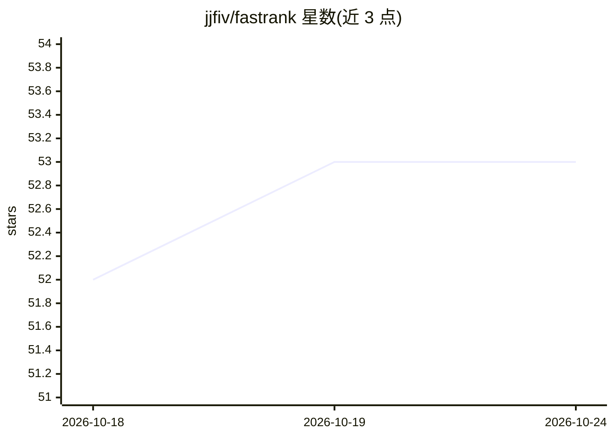

# jjfiv/fastrank

⭐ 53 · Rust · MIT · 推送 2026-09-22 · [GitHub](https://github.com/jjfiv/fastrank) · [官网](https://jjfoley.me/2019/10/11/fastrank-alpha.html) · 个人维护

**学习排序算法的 Rust 实现库，供 Python 调用**

作者将常用 learning-to-rank 算法（coordinate ascent、随机森林等 RankLib 系）移植到 Rust 以提升效率，通过 pip 安装的 Python 包提供使用。README 声明 0.4 版为 alpha，原因是 API 尚需打磨而非正确性问题。版本历史记录了 Python 版本要求变化：0.5 前需 Python 3.5 且无 Windows 构建，0.8 起需 Python 3.7 以使用 @dataclass。提供 Colab 示例笔记本。

## 筛选速览

| 维度 | 判定 | 备注 |
|---|---|---|
| AI 角色 | `ai-native` | 本体是模型或模型工具 |
| 许可风险 | `permissive` | MIT |
| 部署形态 | `library` | 以包/库形式分发 |
| 模型依赖 | — | README 未给出锁定关系 |
| 硬件要求 | — | 无带数字的原话,不猜 |
| 安装摩擦 | `low` | 无编译、无系统依赖或容器化 |
| 成熟度 | `idea` | |

## 能力要点

- RankLib 系学习排序算法的 Rust 移植
- pip install fastrank 即可使用
- 0.6.1 起使用 manylinux2010 构建

## 适用场景

- 在 Python 中训练学习排序模型
- 对搜索或推荐候选结果做排序
- 需要比原实现更高效率的 LTR 场景

## 场景标签

`推荐系统` · 领域:学习与行业

## 证据(README 行号)

> L3: My most frequently used learning-to-rank algorithms ported to rust for efficiency.

## 星数曲线

2026-10-18 52 → 2026-10-24 53（+1）

---
*卡片 v1 · prompt 1.4 · 生成 2026-10-24 · 置信度 mid · 依据 README sha `85fa09ba22c0` · [字段定义](../../DATASET.md)*
