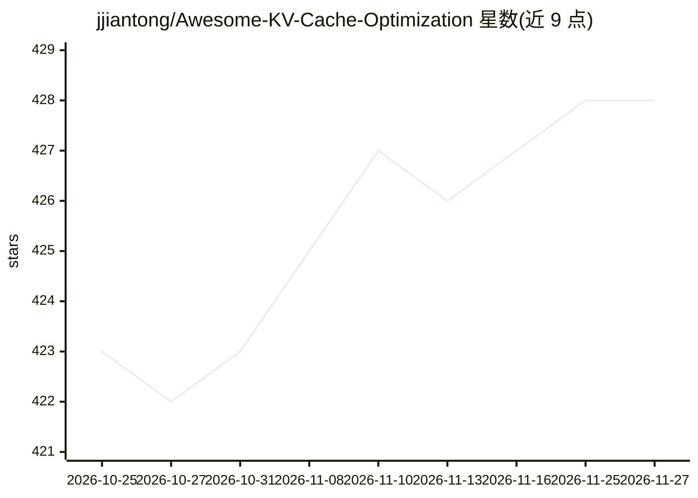

# jjiantong/Awesome-KV-Cache-Optimization

⭐ 428 · Python · 推送 2026-10-23 · [GitHub](https://github.com/jjiantong/Awesome-KV-Cache-Optimization) · [官网](https://jjiantong.github.io/Awesome-KV-Cache-Optimization/) · 组织维护

**LLM 服务中 KV Cache 优化方法的持续更新论文集**

配套 ACL 2026 Findings 综述论文的文献集合仓库，收录无需重训练或架构修改、面向服务时系统指标的 KV Cache 优化工作，按自提出的系统行为导向分类法组织为 Temporal/Spatial/Structural 三类，并分析跨行为协同设计与行为-目标效应。仓库以表格形式列出各论文的类型描述与代码链接，持续更新并新增 Tools、Simulators & Benchmarking 资源章节及交互式论文浏览网站。

## 筛选速览

| 维度 | 判定 | 备注 |
|---|---|---|
| AI 角色 | `ai-knowledge` | 知识聚合/清单类 |
| 许可风险 | `none` | — |
| 部署形态 | `None` |  |
| 模型依赖 | — | README 未给出锁定关系 |
| 硬件要求 | — | 无带数字的原话,不猜 |
| 安装摩擦 | `medium` | 含编译或系统依赖之一 |
| 成熟度 | — | 结构信号不足 |

## 能力要点

- 按 Temporal/Spatial/Structural 系统行为分类法组织文献
- 聚焦服务时、系统感知、KV 中心的优化方法（sKis 范围）
- 持续更新，2026-10 新增 63 篇论文与工具/仿真/基准资源章节
- 配套交互式论文浏览网站

## 适用场景

- 调研 KV Cache 调度、流水线、缓存管理等 LLM 服务优化方向
- 为推理系统研究查找相关工作与开源代码
- 按分类法定位尚未被充分研究的问题区域

## 场景标签

`科研工具` `精选清单` · 领域:学习与行业

## 证据(README 行号)

> L9: This repository accompanies our survey paper (**ACL 2026 Findings**):
> L15: This repository maintains a continuously updated collection of **system-aware, serving-time, KV-centric** optimizat

## 星数曲线

2026-10-25 423 → 2026-11-27 428（+5）

---
*卡片 v1 · prompt 1.4 · 生成 2026-11-25 · 置信度 high · 依据 README sha `125462acc453` · [字段定义](../../DATASET.md)*
