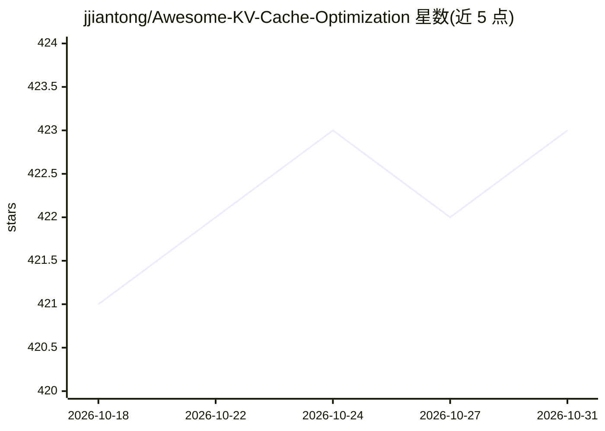

# jjiantong/Awesome-KV-Cache-Optimization

⭐ 423 · Python · 推送 2026-10-23 · [GitHub](https://github.com/jjiantong/Awesome-KV-Cache-Optimization) · [官网](https://jjiantong.github.io/Awesome-KV-Cache-Optimization/) · 组织维护 · 中文 README

**LLM 服务中 KV 缓存优化论文综述清单**

配合 ACL 2026 Findings 综述论文维护的文献集合：收录面向服务时、无需重训练或架构修改的系统级 KV 缓存优化方法（作者称为 sKis 范围），按 Temporal/Spatial/Structural 三类系统行为导向分类组织条目，持续更新（如 2026-10 新增 63 篇），并含工具/模拟器/基准资源章节。面向 LLM 推理服务与系统方向的研究者，用于检索方法与追踪新工作。仓库本身不含可运行代码。

## 筛选速览

| 维度 | 判定 | 备注 |
|---|---|---|
| AI 角色 | `ai-knowledge` | 知识聚合/清单类 |
| 许可风险 | `none` | — |
| 部署形态 | `None` |  |
| 模型依赖 | — | README 未给出锁定关系 |
| 硬件要求 | — | 无带数字的原话,不猜 |
| 安装摩擦 | `medium` | 含编译或系统依赖之一 |
| 成熟度 | — | 结构信号不足 |

## 能力要点

- 按 Temporal/Spatial/Structural 系统行为分类组织论文
- 持续更新收录（2026-10 单次新增 63 篇）
- 配套综述论文（ACL 2026 Findings）与交互式论文浏览网站
- 含工具、模拟器与基准资源章节

## 适用场景

- 查找 LLM serving 的 KV 缓存优化方法论文
- 按调度/卸载/压缩等系统行为定位相关工作
- 追踪该方向的最新论文动态

## 场景标签

`精选清单` `科研工具` · 领域:学习与行业

## 证据(README 行号)

> L9: This repository accompanies our survey paper (**ACL 2026 Findings**):
> L15: This repository maintains a continuously updated collection of **system-aware, serving-time, KV-centric** optimizat
> L40: ## Temporal — Execution & Scheduling

## 星数曲线

2026-10-18 421 → 2026-10-31 423（+2）

---
*卡片 v1 · prompt 1.4 · 生成 2026-10-21 · 置信度 high · 依据 README sha `cb1f76919082` · [字段定义](../../DATASET.md)*
