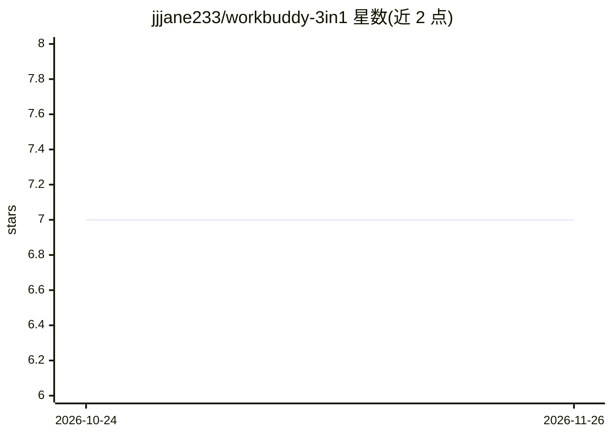

# jjjane233/workbuddy-3in1

⭐ — · [GitHub]() · 个人维护 · 中文 README

**把 CodeBuddy/Trae/ZCode 三种账号收敛为一套 OpenAI 兼容 API 的自托管网关**

以 Go 编写的单二进制 AI 网关，将腾讯 CodeBuddy、Trae Code、ZCode 三条私有协议上游转换为同一个 /v1/chat/completions 端点，供现有 OpenAI SDK/IDE/CLI 调用。机制包括按 provider 硬隔离的多账号池（最早到期优先、加权随机选号）、429/404/402 熔断与冷却、会话粘性、定时签到/保活/额度刷新，以及内嵌单页 Web 面板做账号运维与配置热改。README 声明逆向方案会随客户端升级失效，且仅限本人授权账号私有环境自用，禁止批量分发额度。

## 筛选速览

| 维度 | 判定 | 备注 |
|---|---|---|
| AI 角色 | `ai-ecosystem` | LLM/agent 周边工具 |
| 许可风险 | `permissive` | — |
| 部署形态 | `desktop` | 安装包/桌面程序 |
| 模型依赖 | — | README 未给出锁定关系 |
| 硬件要求 | — | 无带数字的原话,不猜 |
| 安装摩擦 | `low` | 无编译、无系统依赖或容器化 |
| 成熟度 | — | 结构信号不足 |

## 能力要点

- 三上游共用一个 OpenAI 兼容端点，按模型名前缀或 X-Provider 头分派
- provider 隔离账号池：熔断冷却、排队自动换号、会话粘性
- 定时签到、成长任务、保活与额度刷新，三上游排程独立
- 内嵌 Web 面板：账号运维、用量统计、模型目录、配置热生效

## 适用场景

- 用现有 OpenAI SDK 调用自己 CodeBuddy/Trae/ZCode 账号里的模型
- 多账号额度池化管理，被限流时自动换号
- 私有部署中通过面板统一做签到、保活与额度运维

## 场景标签

`模型网关` · 领域:Agent 开发

## 证据(README 行号)

> L3:  把 CodeBuddy / Trae Code / ZCode 三种账号，同时变成一套 OpenAI 兼容 API
> L44: 本分支把这三条完全不同的链路，收敛成**同一个 OpenAI 兼容端点**：
> L125: |**provider 隔离的账号池**|选号、加权随机、余额分层**以及兜底路径**全部按 `provider` 硬过滤，三条上游的账号不会互相串号（`internal/pool/`）|

## 星数曲线

2026-10-24 7 → 2026-11-26 7（+0）

---
*卡片 v1 · prompt 1.4 · 生成 2026-11-20 · 置信度 high · 依据 README sha `b4ebb05d5afa` · [字段定义](../../DATASET.md)*
