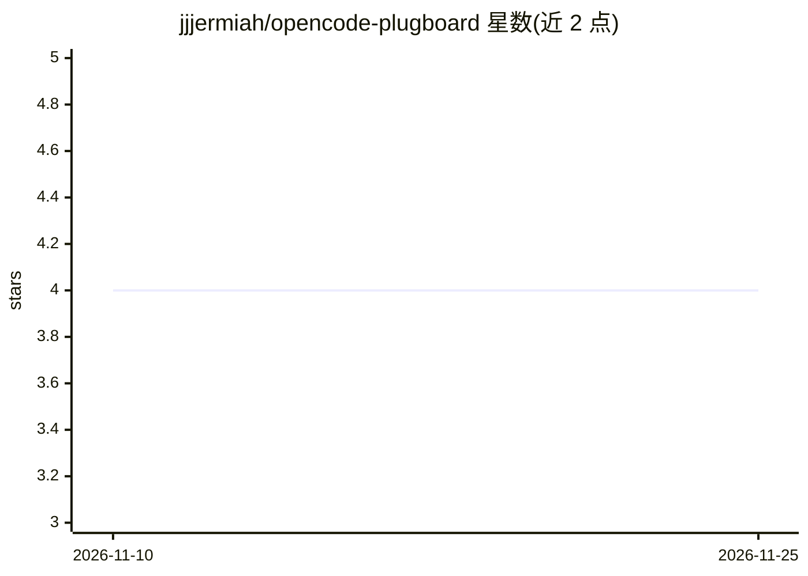

# jjjermiah/opencode-plugboard

⭐ 4 · TypeScript · MIT · 推送 2026-11-23 · [GitHub](https://github.com/jjjermiah/opencode-plugboard) · [官网](https://jjjermiah.github.io/opencode-plugboard/) · 个人维护

**将 OpenCode 已登录模型以 OpenAI/Anthropic/Gemini API 形式对外提供**

OpenCode V2 插件：在 OpenCode 服务器内开启 HTTP 监听，把请求转为 OpenCode 会话并复用用户已有的 provider 登录（ChatGPT、Claude、GitHub Copilot 等）。每个应用有独立 key、模型范围、限额与缓存；支持流式、工具调用、结构化输出、图像/PDF，提供用量统计、仪表盘、TUI 与 Prometheus 指标。0.x 版本，次版本可能变更选项或默认值；工具调用回传给应用，OpenCode 不执行。

## 筛选速览

| 维度 | 判定 | 备注 |
|---|---|---|
| AI 角色 | `ai-ecosystem` | LLM/agent 周边工具 |
| 许可风险 | `permissive` | MIT |
| 部署形态 | `None` |  |
| 模型依赖 | — | README 未给出锁定关系 |
| 硬件要求 | — | 无带数字的原话,不猜 |
| 安装摩擦 | `low` | 无编译、无系统依赖或容器化 |
| 成熟度 | `idea` | |

## 能力要点

- 在 OpenCode 服务器内提供 OpenAI Chat Completions、Responses、Anthropic Messages、Gemini 兼容端点
- 每应用独立 key、模型别名、fallback 链与限额预算
- 响应缓存与 per-app 用量统计、仪表盘、TUI、Prometheus 指标
- bunx init 一条命令写入全局 OpenCode 配置并生成应用 key

## 适用场景

- 让只支持 OpenAI/Anthropic/Gemini API 的应用复用 OpenCode 已登录的模型
- 为多个应用分发独立 API key 并分别设限额与预算
- 在自托管服务器上向局域网内其他机器提供模型 API

## 场景标签

`模型网关` · 领域:Agent 开发

## 证据(README 行号)

> L9:  Apps call plugboard with the OpenAI, Anthropic or Gemini API. Plugboard runs inside your OpenCode server, turns eac
> L13: Plugboard is an OpenCode V2 plugin. It opens an HTTP listener inside your OpenCode server and answers those APIs wi
> L49: |OpenAI Chat Completions|`POST /v1/chat/completions`|

## 星数曲线

2026-11-10 4 → 2026-11-25 4（+0）

---
*卡片 v1 · prompt 1.4 · 生成 2026-11-21 · 置信度 high · 依据 README sha `8bef12ad94eb` · [字段定义](../../DATASET.md)*
