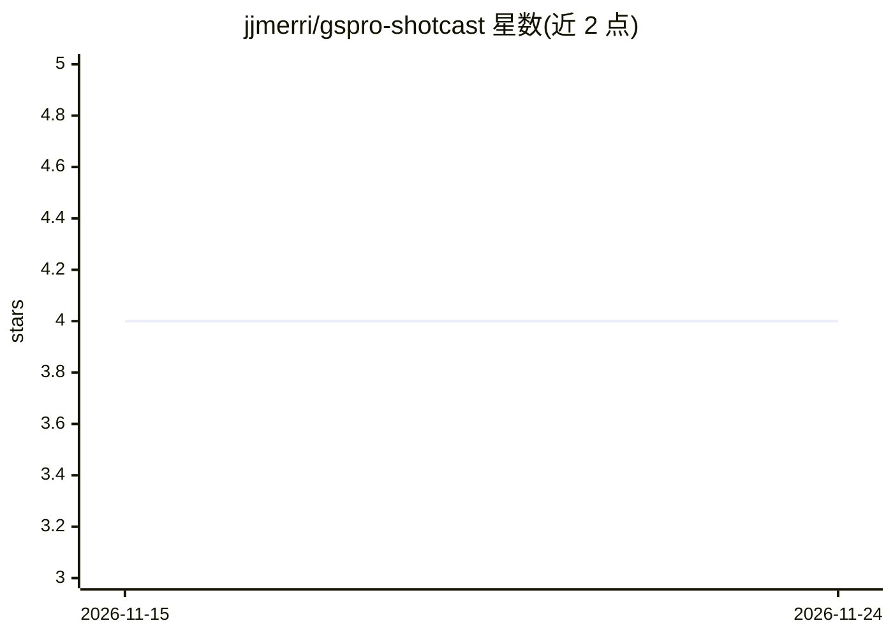

# jjmerri/gspro-shotcast

⭐ 4 · Python · NOASSERTION · 推送 2026-11-23 · [GitHub](https://github.com/jjmerri/gspro-shotcast) · 个人维护

**为 GSPro 高尔夫模拟器提供挥杆记录、统计页面与 AI 实时解说**

运行在 GSPro 模拟器所在 Windows PC 上的伴生工具：读取 GSPro 的日志与屏幕画面（OCR），把每次挥杆的球速、落点、成绩写入本地 SQLite 数据库，无需云服务、账号或 API key；据此生成本地统计页面（strokes gained、球杆距离分布、记分卡、洞回放、差点指数），可发布为密码保护的在线页面供联盟查看。解说台部分读取挥杆数据、联盟名册与赛程，经 LLM 与 TTS 生成两名评论员的实时语音解说，支持云端模型（每轮约 $0.40-0.60）或全本地模型（$0）。

## 筛选速览

| 维度 | 判定 | 备注 |
|---|---|---|
| AI 角色 | `ai-enhanced` | 去掉 AI 部分产品仍成立 |
| 许可风险 | `none` | NOASSERTION |
| 部署形态 | `desktop` | 安装包/桌面程序 |
| 模型依赖 | — | README 未给出锁定关系 |
| 硬件要求 | — | 无带数字的原话,不猜 |
| 安装摩擦 | `low` | 无编译、无系统依赖或容器化 |
| 成熟度 | — | 结构信号不足 |

## 能力要点

- 每杆入本地 SQLite，无需云服务与账号（L9-L10）
- 统计页含 strokes gained、club gapping、差点指数与洞回放
- 两名 AI 评论员实时解说，LLM→TTS→扬声器管线（L177）
- 云端或全本地模型均可运行，本地方案无需 API key（L118-L119, L193）

## 适用场景

- 记录模拟高尔夫每轮成绩并查看赛季统计
- 联盟成员通过密码页面查看各自数据与回放
- 为联赛之夜配上实时 AI 解说广播

## 场景标签

`语音合成` `OCR` · 领域:内容生成

## 证据(README 行号)

> L7: - **Shot tracking.** GSPro shows a scorecard and forgets it. Shotcast keeps every swing: launch
> L16: - **The booth.** Two AI commentators call your round live through the speakers. They know the
> L177: Screen (framebuffer) ─► OCR ────► who's up, HUD tiles, minimap ──┼─► engine ─► LLM ─► TTS ─► speakers

## 星数曲线

2026-11-15 4 → 2026-11-24 4（+0）

---
*卡片 v1 · prompt 1.4 · 生成 2026-11-21 · 置信度 high · 依据 README sha `da9cc68ae821` · [字段定义](../../DATASET.md)*
