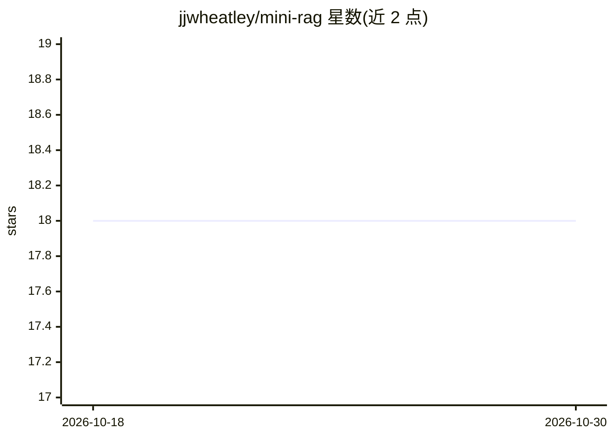

# jjwheatley/mini-rag

⭐ 18 · TypeScript · MIT · 推送 2026-10-17 · [GitHub](https://github.com/jjwheatley/mini-rag) · 个人维护

**Obsidian 插件：基于本地 LLM 对笔记做 RAG 对话与摘要**

面向 Obsidian 用户的桌面端社区插件：对选中的笔记或文件夹分块、生成向量嵌入，检索语义相关片段随问题发送给本地 LLM，实现上下文对话、追问、流式输出与分阶段摘要。支持 Ollama 与 llama.cpp 两种本地服务器作为 Provider，可选专用嵌入模型，嵌入可缓存到磁盘。限制：仅桌面端运行，默认关闭缓存，且缓存以未加密 JSON 存储笔记文本与嵌入向量。

## 筛选速览

| 维度 | 判定 | 备注 |
|---|---|---|
| AI 角色 | `ai-native` | 本体是模型或模型工具 |
| 许可风险 | `permissive` | MIT |
| 部署形态 | `None` |  |
| 模型依赖 | local-ok | 支持本地模型 |
| 硬件要求 | — | 无带数字的原话,不猜 |
| 安装摩擦 | `low` | 无编译、无系统依赖或容器化 |
| 成熟度 | — | 结构信号不足 |

## 能力要点

- 对笔记/文件夹分块并生成向量嵌入后检索相关片段
- 支持 Ollama 与 llama.cpp 两种本地服务器，各自记忆 URL 与模型选择
- 分阶段摘要大文件夹，逐部分汇总为完整摘要
- 嵌入磁盘缓存按内容哈希增量更新，自动写入 .gitignore

## 适用场景

- 在自己的 Obsidian 笔记上做本地 RAG 问答，数据不出本机
- 对整个文件夹的笔记生成分阶段汇总摘要
- 在本地 Ollama 或 llama.cpp 服务间切换并保留各自配置

## 场景标签

`RAG` `文档问答` · 领域:知识与检索

## 证据(README 行号)

> L5: Mini-RAG lets you chat with a locally running LLM, in the context of selected Obsidian notes and folders. When you o
> L7: It works with either of two local servers:

## 星数曲线

2026-10-18 18 → 2026-10-30 18（+0）

---
*卡片 v1 · prompt 1.4 · 生成 2026-10-29 · 置信度 high · 依据 README sha `96b829471e24` · [字段定义](../../DATASET.md)*
