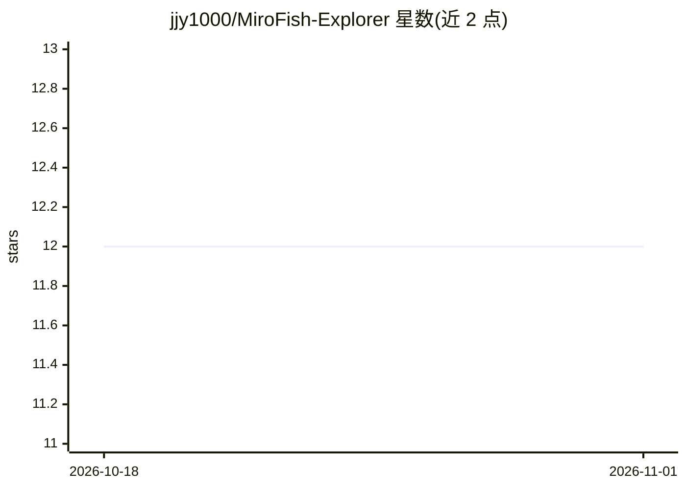

# jjy1000/MiroFish-Explorer

⭐ 12 · Python · AGPL-3.0 · 推送 2026-07-21 · [GitHub](https://github.com/jjy1000/MiroFish-Explorer) · [官网](https://github.com/666ghj/MiroFish) · 个人维护 · 中文 README

**群体智能推演引擎探索版：数字世界仿真+命令工作流**

MiroFish 的 fork 扩展版本：基于 OASIS 多智能体引擎，上传种子材料后构建智能体数字世界进行推演。本 fork 在上游核心之上新增圆桌推演、政策推演、因果推断（DoWhy/EconML）、多种博弈论求解器、Tauri 2 桌面端（macOS/Windows，内嵌 Neo4j+JRE）及 Explorer 分支独有的 Command Workflow（结构化命令驱动推演，支持 reset/inject/sweep 等命令）。技术栈为 Vue 3 + Flask 3 + Neo4j，支持源码部署与 Docker Compose 一键部署，AGPL v3 协议，项目自述处于加速开发中。

## 筛选速览

| 维度 | 判定 | 备注 |
|---|---|---|
| AI 角色 | `ai-native` | 本体是模型或模型工具 |
| 许可风险 | `viral` | AGPL-3.0 |
| 部署形态 | `self-host` | docker 或自建部署 |
| 模型依赖 | — | README 未给出锁定关系 |
| 硬件要求 | — | 无带数字的原话,不猜 |
| 安装摩擦 | `low` | 无编译、无系统依赖或容器化 |
| 成熟度 | `idea` | |

## 能力要点

- Command Workflow：结构化命令编排推演流程（参数扫描、快照导出）
- 圆桌推演、政策推演、智能体辩论等推演模式，token 级 SSE 流式输出
- 因果推断（DoWhy/EconML）与多种博弈论求解器（Gambit/OpenSpiel 等）
- Tauri 2 桌面端（macOS/Windows），内嵌 Neo4j + JRE，可离线运行

## 适用场景

- 用命令式指令批量推演、参数扫描、复现论文
- 构建智能体数字世界观察群体演化与意见动力学
- 在桌面端离线运行政策推演与因果分析

## 场景标签

`多智能体` `科研工具` · 领域:Agent 开发

## 证据(README 行号)

> L28: MiroFish 是一个简洁通用的群体智能引擎：上传种子材料（新闻、报告、小说等）后，它会**自动构建一个高保真的平行数字世界**，让成千上万具备独立人格、长期记忆和行为逻辑的智能体在其中自由交互和演化，从而推演未来的轨迹。
> L45: |🟡 **本 fork 自行扩展**（**非上游提供**）|上游没有，本 fork 自行开发|圆桌推演、政策推演、因果推断（DoWhy / EconML）、博弈论求解器（Gambit / OpenSpiel / Network G
> L189: - **OASIS**（camel-ai/oasis）多智能体仿真

## 星数曲线

2026-10-18 12 → 2026-11-01 12（+0）

---
*卡片 v1 · prompt 1.4 · 生成 2026-11-01 · 置信度 high · 依据 README sha `d219d83aa1ef` · [字段定义](../../DATASET.md)*
