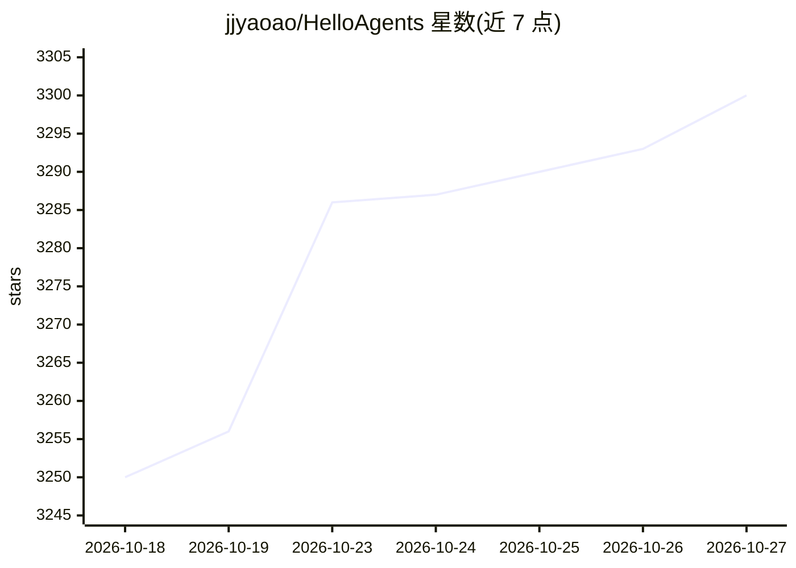

# jjyaoao/HelloAgents

⭐ 3,300 · Python · NOASSERTION · 推送 2026-10-06 · [GitHub](https://github.com/jjyaoao/HelloAgents) · 个人维护 · 中文 README

**面向智能体开发的组件化多智能体框架（Python）**

基于原生 Function Calling 的组件化多智能体框架，为智能体开发提供可组合的工程组件：Agent Loop、工具执行与 ToolResponse 协议、上下文工程、会话持久化、子代理、Skills、RAG/GraphRAG 知识检索、语义记忆与用户画像、MCP 工具接入、熔断与后台任务。提供 3 种 LLM 适配器（OpenAI 兼容/Anthropic/Gemini），按 base_url 自动选择；检索、记忆与上下文组件可独立使用。源自 Datawhale Hello-Agents 教程，维护学习分支与当前版本，许可证为 CC BY-NC-SA 4.0（非商业，商业需授权）。

## 筛选速览

| 维度 | 判定 | 备注 |
|---|---|---|
| AI 角色 | `ai-ecosystem` | LLM/agent 周边工具 |
| 许可风险 | `none` | NOASSERTION |
| 部署形态 | `library` | 以包/库形式分发 |
| 模型依赖 | local-ok | 支持本地模型 |
| 硬件要求 | — | 无带数字的原话,不猜 |
| 安装摩擦 | `low` | 无编译、无系统依赖或容器化 |
| 成熟度 | — | 结构信号不足 |

## 能力要点

- 基于原生 Function Calling 的可组合 Agent Loop（SimpleAgent 快速起步）
- RAG/GraphRAG、持久记忆、语义检索与结构化用户画像
- 3 种 LLM 适配器（OpenAI 兼容/Anthropic/Gemini）按 base_url 自动选择
- MCP 工具接入、子代理、调用预算、熔断与运行追踪

## 适用场景

- 搭建具备工具调用与记忆的多智能体应用
- 为智能体应用加入 RAG/GraphRAG 知识检索
- 跟随 Datawhale Hello-Agents 教程学习智能体开发

## 场景标签

`多智能体` `Agent 框架` `教程课程` · 领域:Agent 开发

## 证据(README 行号)

> L8: HelloAgents 是一个围绕原生 Function Calling 构建的**组件化多智能体框架**，从简单的工具调用循环，到具备上下文管理、知识检索、持久记忆与多智能体协作的应用，为智能体开发提供可组合的工程组件。
> L10: 框架集成**工具响应协议、上下文工程、会话持久化、子代理、Skills、流式输出与运行追踪**，并提供 **MCP 工具接入、RAG 与 GraphRAG、结构化用户画像、语义记忆检索和后台任务**。通过 `SimpleAgent

## 星数曲线

2026-10-18 3,250 → 2026-10-27 3,300（+50）

---
*卡片 v1 · prompt 1.4 · 生成 2026-10-20 · 置信度 high · 依据 README sha `7dc2b884ca73` · [字段定义](../../DATASET.md)*
