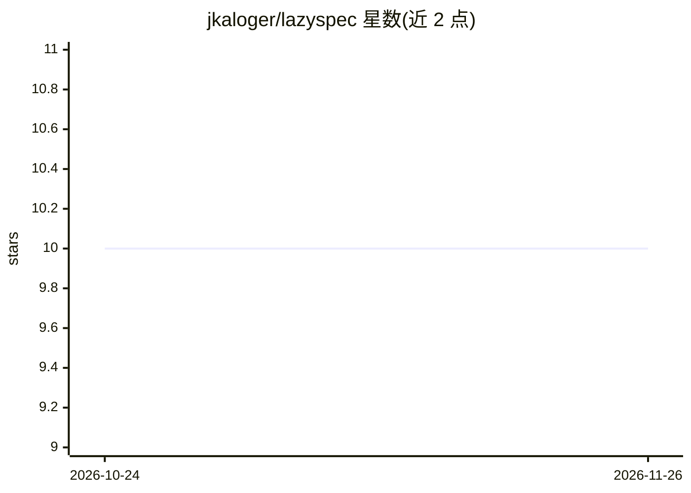

# jkaloger/lazyspec

⭐ 10 · Rust · MIT · 推送 2026-11-10 · [GitHub](https://github.com/jkaloger/lazyspec) · 个人维护

**为人类与 LLM 管理项目文档的 TUI+CLI 上下文工具**

以 Markdown+YAML frontmatter 存储项目文档，通过 `.lazyspec.toml` 配置文档类型、关系、生命周期状态、模板与存储后端。CLI 提供 create/link/search/validate/fix/govern/hook 等命令，TUI 提供文档导航、图视图、Markdown 预览与校验发现展示。存储后端支持 filesystem、github-issues/projects 等多种。`governs` 机制将文档与源码路径关联并检测过期；hooks 可在 validate 与状态迁移事件挂接外部命令。项目自称 experimental，接口可能在版本间变更。安装部分在 README 可见范围之外（L165 之后）。

## 筛选速览

| 维度 | 判定 | 备注 |
|---|---|---|
| AI 角色 | `ai-enhanced` | 去掉 AI 部分产品仍成立 |
| 许可风险 | `permissive` | MIT |
| 部署形态 | `desktop` | 安装包/桌面程序 |
| 模型依赖 | — | README 未给出锁定关系 |
| 硬件要求 | — | 无带数字的原话,不猜 |
| 安装摩擦 | `low` | 无编译、无系统依赖或容器化 |
| 成熟度 | `idea` | |

## 能力要点

- Markdown+YAML frontmatter 文档存储，CLI 可创建/链接/搜索/校验文档
- 支持 filesystem、github-issues、github-milestones、git 等多种存储后端
- governs 机制将文档与源码 glob 关联，输出 fresh/aging/stale 过期状态
- hooks 支持在 validate 与 pre-transition 事件运行外部命令并回写文档

## 适用场景

- 用规格/决策文档管理代码库并保持与源码的对应关系
- 通过 CLI 生成结构化项目上下文供 LLM 使用
- 在 TUI 中浏览文档关系图并处理校验发现

## 场景标签

`知识库管理` · 领域:知识与检索

## 证据(README 行号)

> L6: Lazyspec manages project documents through a TUI and a command line interface.
> L15: Lazyspec stores documents as Markdown with YAML frontmatter. `.lazyspec.toml` defines document types, relationships

## 星数曲线

2026-10-24 10 → 2026-11-26 10（+0）

---
*卡片 v1 · prompt 1.4 · 生成 2026-11-19 · 置信度 mid · 依据 README sha `59c6da26421c` · [字段定义](../../DATASET.md)*
