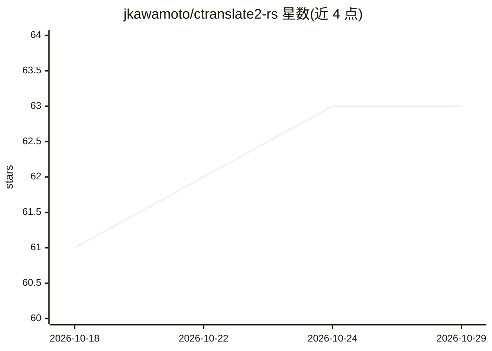

# jkawamoto/ctranslate2-rs

⭐ 63 · Rust · MIT · 推送 2026-10-25 · [GitHub](https://github.com/jkawamoto/ctranslate2-rs) · [官网](https://docs.rs/ct2rs) · 个人维护

**CTranslate2 的 Rust 绑定库：在 Rust 中运行推理**

为 OpenNMT/CTranslate2 推理引擎提供 Rust 绑定的库。开发者通过 Cargo.toml 引入 ct2rs crate 并按需选择计算后端 feature（CUDA/cuDNN、Intel MKL、OpenBLAS、oneDNN、ruy、Apple Accelerate 等），另支持 Flash Attention、Tensor Parallelism、流式回调 API 与 SentencePiece/HuggingFace Tokenizers。已测试可运行 BART、BLOOM、FALCON、Marian-MT、GPT-2、Whisper 等模型。编译需要 CMake，模型文件需先转换为 CTranslate2 格式。

## 筛选速览

| 维度 | 判定 | 备注 |
|---|---|---|
| AI 角色 | `ai-ecosystem` | LLM/agent 周边工具 |
| 许可风险 | `permissive` | MIT |
| 部署形态 | `library` | 以包/库形式分发 |
| 模型依赖 | — | README 未给出锁定关系 |
| 硬件要求 | — | 无带数字的原话,不猜 |
| 安装摩擦 | `high` | 编译与系统依赖俱全 |
| 成熟度 | — | 结构信号不足 |

## 能力要点

- 以 feature 选择方式接入 CUDA/MKL/oneDNN/ruy/Accelerate 等多种计算后端
- 流式回调 API 与 HuggingFace Hub 集成 feature
- 已测试支持 BART、BLOOM、FALCON、Whisper 等 11 类模型
- 提供 ct2rs-platform crate 按平台自动选择默认后端

## 适用场景

- 在 Rust 项目中直接调用 CTranslate2 运行 LLM/翻译/Whisper 模型
- 跨平台（Windows/macOS/Linux、CPU/GPU）部署推理后端
- 使用流式 API 构建生成式应用的 Rust 侧接入

## 场景标签

`推理引擎` · 领域:训练与推理

## 证据(README 行号)

> L8: This library provides Rust bindings for OpenNMT/CTranslate2.
> L12: Add this crate to your `Cargo.toml` with selecting the backends you want to use as the features:

## 星数曲线

2026-10-18 61 → 2026-10-29 63（+2）

---
*卡片 v1 · prompt 1.4 · 生成 2026-10-24 · 置信度 mid · 依据 README sha `d5d0dbaf8545` · [字段定义](../../DATASET.md)*
