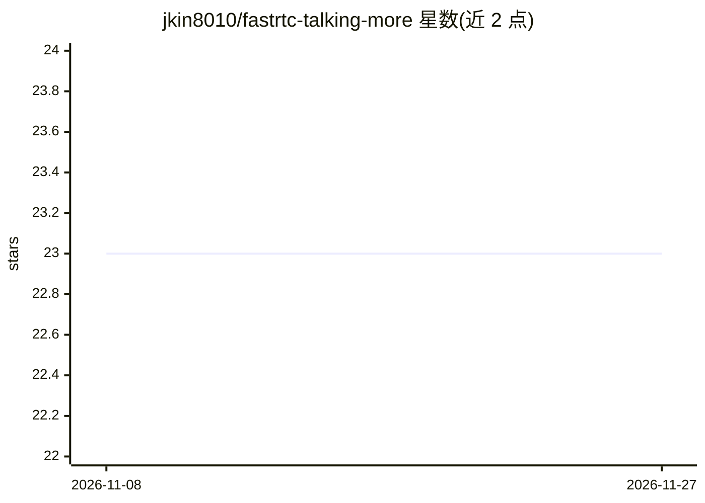

# jkin8010/fastrtc-talking-more

⭐ 23 · Python · MIT · 推送 2026-09-03 · [GitHub](https://github.com/jkin8010/fastrtc-talking-more) · 个人维护 · 中文 README

**基于 FastRTC 的中文实时语音对话 Web 应用**

实时中文语音对话应用：浏览器经 WebRTC 采集语音，FunASR 做中文语音识别，大语言模型（默认 OrcaRouter 的 deepseek/deepseek-v4-flash-0731）生成回复，MegaTTS 或 ChatTTS 合成中文语音返回。所有 LLM Provider 共用一组环境变量，可在注册表添加 OpenAI-compatible Provider。macOS 需先安装 OpenFST 供 pynini 编译；推理设备自动选择 CUDA、Apple MPS、CPU，CPU 上 MegaTTS 较慢。通过 git clone + uv 安装启动，MIT 许可。

## 筛选速览

| 维度 | 判定 | 备注 |
|---|---|---|
| AI 角色 | `ai-native` | 本体是模型或模型工具 |
| 许可风险 | `permissive` | MIT |
| 部署形态 | `None` |  |
| 模型依赖 | — | README 未给出锁定关系 |
| 硬件要求 | — | 无带数字的原话,不猜 |
| 安装摩擦 | `medium` | 含编译或系统依赖之一 |
| 成熟度 | — | 结构信号不足 |

## 能力要点

- WebRTC 实时语音输入输出，Web 界面访问 localhost:7860
- FunASR 中文语音识别 + MegaTTS/ChatTTS 中文语音合成
- 统一 LLM_* 配置切换 Provider，支持注册 OpenAI-compatible Provider
- 推理设备自动选择 CUDA / Apple MPS / CPU

## 适用场景

- 在浏览器中与中文大模型进行实时语音对话
- 本地搭建中文语音助手原型
- 在 Apple Silicon 或 CUDA 环境运行语音对话服务

## 场景标签

`语音 Agent` · 领域:对话与助手

## 证据(README 行号)

> L9: - 🎙️ 实时语音对话：支持实时语音输入和输出
> L10: - 🤖 智能对话：默认基于 OrcaRouter（deepseek/deepseek-v4-flash-0731）大语言模型
> L11: - 🗣️ 语音识别：使用 FunASR 进行中文语音识别
> L12: - 🔊 语音合成：使用 MegaTTS/ChatTTS 进行中文语音合成

## 星数曲线

2026-11-08 23 → 2026-11-27 23（+0）

---
*卡片 v1 · prompt 1.4 · 生成 2026-11-18 · 置信度 high · 依据 README sha `391368445a84` · [字段定义](../../DATASET.md)*
