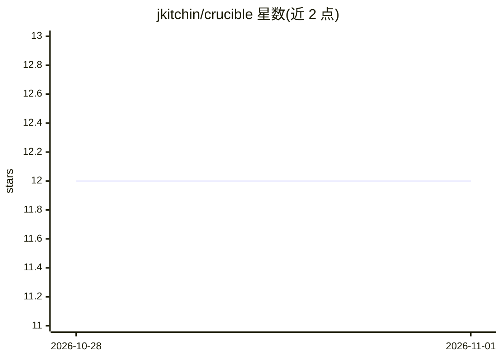

# jkitchin/crucible

⭐ 12 · Python · MIT · 推送 2026-10-28 · [GitHub](https://github.com/jkitchin/crucible) · 个人维护

**科研人员用 LLM 将论文、笔记、数据蒸馏成互联 org-mode 知识库**

面向个人与研究组的个人知识库系统：通过 CLI（crucible ingest/sync/embed/search 等）摄入论文 PDF、网页剪藏、实验笔记与数据，由 Claude（经 Claude Code 技能）阅读源材料、提出并在批准后写入结构化 org-mode wiki 文章。SQLite 图数据库跟踪来源、文章、概念与链接；混合检索结合 FTS5 关键词与 ollama 向量嵌入（倒数排序融合）。设计上区分受版权保护的原始来源与可共享的蒸馏内容，多实例可 peer 互联跨库查询，derivation chain 追踪文章派生历史。以 Python 包（pip）安装，另含 Agent Skills 规范技能文件，可经 knowhow/npx skills 安装到 Claude Code、Cursor 等多种 agent。语义搜索需本机运行 ollama 嵌入模型。

## 筛选速览

| 维度 | 判定 | 备注 |
|---|---|---|
| AI 角色 | `ai-native` | 本体是模型或模型工具 |
| 许可风险 | `permissive` | MIT |
| 部署形态 | `library` | 以包/库形式分发 |
| 模型依赖 | local-ok | 支持本地模型 |
| 硬件要求 | — | 无带数字的原话,不猜 |
| 安装摩擦 | `low` | 无编译、无系统依赖或容器化 |
| 成熟度 | — | 结构信号不足 |

## 能力要点

- LLM 蒸馏循环：摄入源材料后由 Claude 提出并写入 wiki 文章
- SQLite 图数据库跟踪来源/文章/概念/链接关系
- FTS5 关键词 + ollama 向量嵌入的混合检索（倒数排序融合）
- 多实例 peer 互联跨库查询；derivation chain 追踪文章派生历史

## 适用场景

- 为基金申请或综述批量消化论文并沉淀为可检索的结构化知识库
- 实验笔记本入知识库，随时间发现跨实验关联与矛盾
- 课题组各成员维护独立实例，PI 跨库检索并了解学生研究进展

## 场景标签

`知识库管理` `科研工具` · 领域:知识与检索

## 证据(README 行号)

> L9: Crucible is a personal knowledge base system where primary sources (papers,
> L10: notebooks, data) are ingested and distilled by an LLM into a structured,
> L12: directly. Instead, you converse with Claude, and it reads, writes, and
> L16: that raw data from various sources is collected, then compiled by an LLM into

## 星数曲线

2026-10-28 12 → 2026-11-01 12（+0）

---
*卡片 v1 · prompt 1.4 · 生成 2026-11-01 · 置信度 mid · 依据 README sha `ce6c9f22abdd` · [字段定义](../../DATASET.md)*
