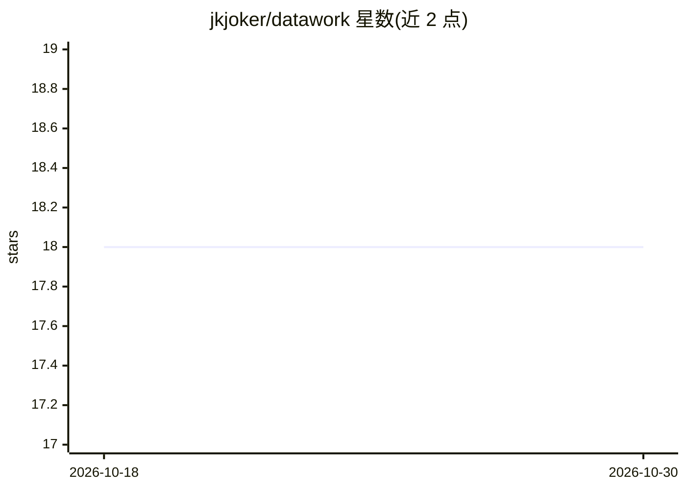

# jkjoker/datawork

⭐ 18 · NOASSERTION · 推送 2026-10-21 · [GitHub](https://github.com/jkjoker/datawork) · [官网](https://publish.obsidian.md/xm/wiki/%E6%95%99%E7%A8%8B/datawork%EF%BC%9Aabout) · 个人维护 · 中文 README

**本地优先的个人 AI Agent 桌面系统，整合对话、任务与知识管理**

datawork 是面向 Windows 10 及以上系统的本地优先个人 AI Agent 桌面应用：将资料、对话、任务、代码和工具置于同一本地工作区，无需账号或登录。提供 Code Agent（编码、调试、文件编辑、脚本执行）、通用 Agent（对话、写作、知识管理）、Workflow、多记忆库与三层 Todo、Python 插件与标准 MCP server 支持、多供应商模型管理、浏览器访问的 Web Studio、AI 调用账本与权限安全护栏。当前为专有软件，源码未开放，桌面安装包是唯一产品形态。

## 筛选速览

| 维度 | 判定 | 备注 |
|---|---|---|
| AI 角色 | `ai-native` | 本体是模型或模型工具 |
| 许可风险 | `none` | NOASSERTION |
| 部署形态 | `None` |  |
| 模型依赖 | — | README 未给出锁定关系 |
| 硬件要求 | — | 无带数字的原话,不猜 |
| 安装摩擦 | `low` | 无编译、无系统依赖或容器化 |
| 成熟度 | — | 结构信号不足 |

## 能力要点

- 本地优先工作区，无需注册登录，数据默认保存在本地
- Code Agent 与通用 Agent 双通道，覆盖编码与日常任务
- 支持 Python 插件与标准 MCP server，模型管理支持多供应商与自定义模型
- AI 调用账本记录用量、费用、耗时，含权限审批与安全护栏

## 适用场景

- 围绕长期本地工作区进行编码、调试与长任务推进
- 日常对话、写作与个人知识管理
- 通过浏览器多端访问本地工作区继续任务

## 场景标签

`AI 助手` `知识库管理` · 领域:对话与助手

## 证据(README 行号)

> L20: datawork 是一个本地优先的个人 AI Agent 系统，把资料、对话、任务、代码和工具放在同一个本地工作区，让 AI 能围绕长期上下文持续协助工作。
> L27: |Code Agent|面向编码、调试、文件编辑、脚本执行、代码研读和长任务推进。|

## 星数曲线

2026-10-18 18 → 2026-10-30 18（+0）

---
*卡片 v1 · prompt 1.4 · 生成 2026-10-29 · 置信度 mid · 依据 README sha `99ca3895fc30` · [字段定义](../../DATASET.md)*
