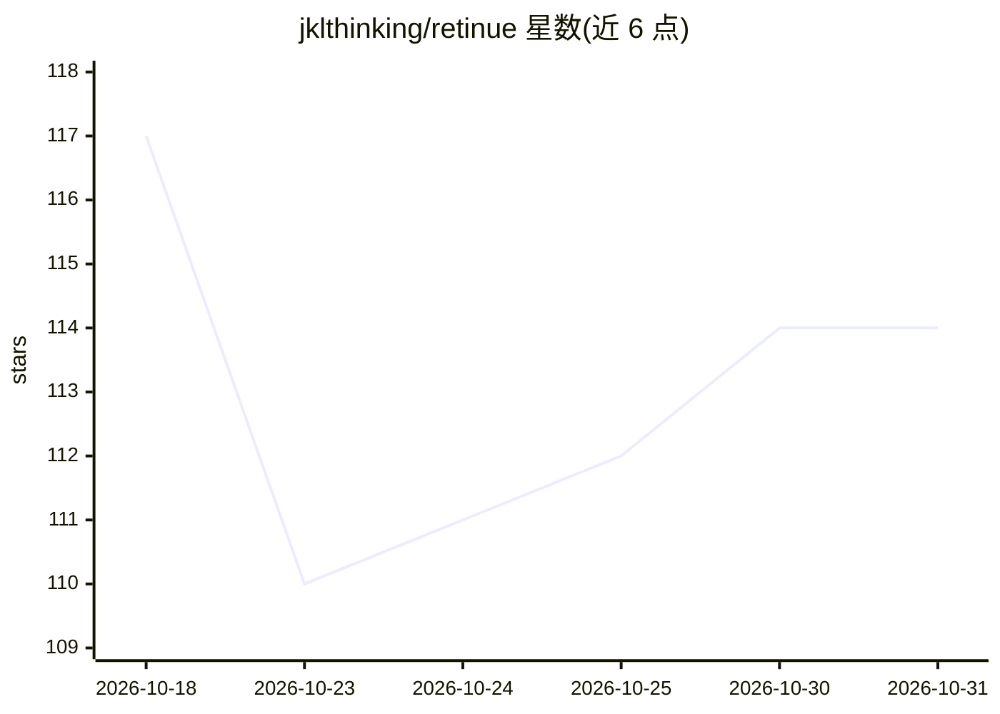

# jklthinking/retinue

⭐ 114 · Python · AGPL-3.0 · 推送 2026-10-22 · [GitHub](https://github.com/jklthinking/retinue) · [官网](https://jklthinking.github.io/retinue/) · 个人维护 · 中文 README

**人与 AI agent 共用的自托管任务看板与协作审计层**

面向运行多个 AI 编码代理的个人与小团队的自托管任务板：每张任务卡有唯一持有人、预定义验收标准与只追加的回执链；agent 通过 MCP 服务器或带 token 的 HTTP API 认领、回报与交付，非持有人写入返回 403。提供 Claude Code 与 Codex 会话的只读用量导入器、Lark/飞书与 Telegram 适配器、Claude/Codex/Grok/Cursor/Kimi 订阅额度采集。无遥测、无托管控制面；Docker Compose 或无 Docker 的文件模式均可运行，AGPL-3.0-only 并附可选商业许可。

## 筛选速览

| 维度 | 判定 | 备注 |
|---|---|---|
| AI 角色 | `ai-ecosystem` | LLM/agent 周边工具 |
| 许可风险 | `dual` | AGPL-3.0 |
| 部署形态 | `self-host` | docker 或自建部署 |
| 模型依赖 | locked-api |  |
| 硬件要求 | — | 无带数字的原话,不猜 |
| 安装摩擦 | `low` | 无编译、无系统依赖或容器化 |
| 成熟度 | — | 结构信号不足 |

## 能力要点

- 每卡唯一持有人与 holder-only-writes 写入约束
- claim/进度/交接/验收的只追加回执链
- retinue-server mcp 向任意 MCP 客户端暴露看板，另有 HTTP + token API
- Claude Code / Codex 只读会话导出器与订阅额度采集

## 适用场景

- 给多个 AI 编码代理和人共用一块有审计记录的任务板
- 核验每张卡的持有人、回报与验收是否真实通过
- 在 NAS 或单机上自托管，不接托管 agent 平台

## 场景标签

`多智能体` · 领域:Agent 开发

## 证据(README 行号)

> L16: self-hosted task board and orchestration hub where a mixed team of people and
> L88: framework — it is the shared board and audit layer that sits underneath
> L100: - **MCP-native coordination.** `retinue-server mcp` exposes the board to any

## 星数曲线

2026-10-18 117 → 2026-10-31 114（-3）

---
*卡片 v1 · prompt 1.4 · 生成 2026-10-23 · 置信度 high · 依据 README sha `1ac5c6ff5182` · [字段定义](../../DATASET.md)*
