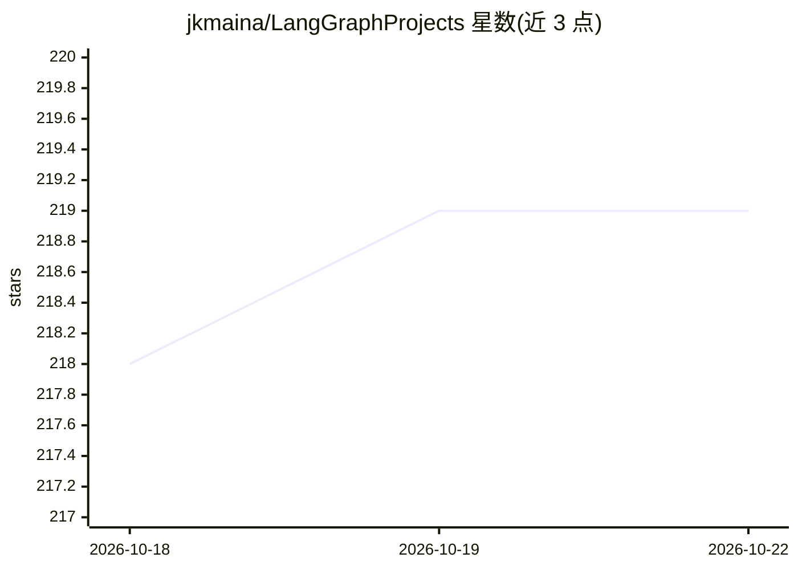

# jkmaina/LangGraphProjects

⭐ 219 · Python · NOASSERTION · 推送 2026-01-10 · [GitHub](https://github.com/jkmaina/LangGraphProjects) · [官网](https://www.amazon.com/Complete-LangGraph-Blueprint-Business-Success-ebook/dp/B0DP69QV7K) · 个人维护

**LangGraph 图书配套代码库：50+ AI agent 分章示例与教程**

书籍 The Complete LangGraph Blueprint 的官方配套仓库，按章节组织源码，提供使用 LangGraph 构建 50+ 个面向商业场景 AI agent 的分步教程与练习，覆盖图结构工作流（节点/边/状态）、GPT-4 等 LLM 集成、工具节点接入 API、短期/长期记忆实现，应用场景含客服、医疗与金融。运行需 Python 3.10+，安装 langgraph/langchain_openai 等依赖并配置 OpenAI API key，从 chapter1/lesson1a.py 开始执行。书本体需在 Amazon 购买，仓库代码以 Apache 2.0 许可。

## 筛选速览

| 维度 | 判定 | 备注 |
|---|---|---|
| AI 角色 | `ai-knowledge` | 知识聚合/清单类 |
| 许可风险 | `none` | NOASSERTION |
| 部署形态 | `library` | 以包/库形式分发 |
| 模型依赖 | — | README 未给出锁定关系 |
| 硬件要求 | — | 无带数字的原话,不猜 |
| 安装摩擦 | `low` | 无编译、无系统依赖或容器化 |
| 成熟度 | — | 结构信号不足 |

## 能力要点

- 50+ 个 AI agent 的分章源码与练习
- 讲解节点/边/状态/条件的图结构工作流
- 涵盖工具节点接入 API 与短期/长期记忆实现
- 提供虚拟环境搭建、依赖安装与 API key 配置步骤

## 适用场景

- 跟随书籍分章练习 LangGraph agent 开发
- 查找客服/医疗/金融场景的 agent 示例代码
- 学习 LangGraph 节点、边、状态与工具节点的用法

## 场景标签

 · 领域:LLM 应用开发/教程

## 证据(README 行号)

> L5: Welcome to the official repository for **The Complete LangGraph Blueprint**, authored by James Karanja Maina. This b
> L9: This project is a comprehensive guide to building AI agents using LangGraph, an open-source framework for graph-base

## 星数曲线

2026-10-18 218 → 2026-10-22 219（+1）

---
*卡片 v1 · prompt 1.4 · 生成 2026-10-22 · 置信度 high · 依据 README sha `7b93f5bd1d2b` · [字段定义](../../DATASET.md)*
