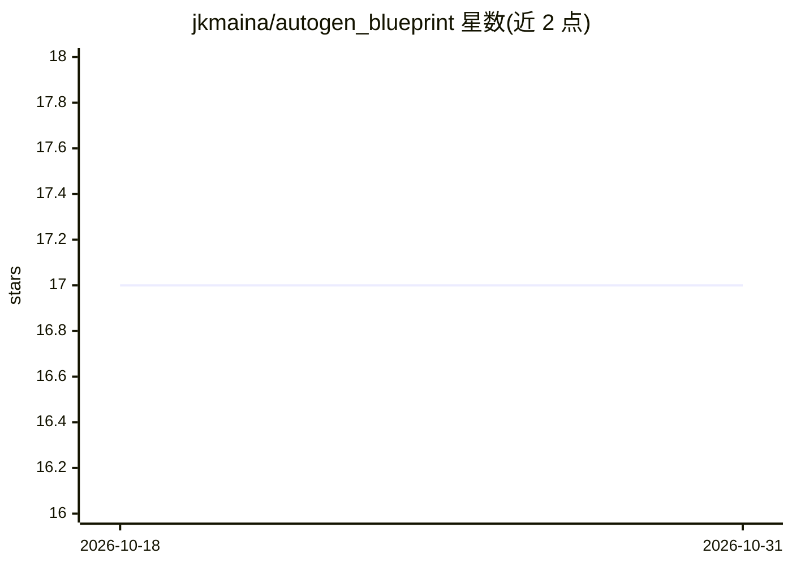

# jkmaina/autogen_blueprint

⭐ 17 · Python · 推送 2026-01-10 · [GitHub](https://github.com/jkmaina/autogen_blueprint) · [官网](https://www.amazon.com/Complete-AutoGen-Agent-Blueprint-Developers-ebook/dp/B0FFLJT82T) · 个人维护

**AutoGen 多智能体开发书籍的配套代码示例仓库**

《The Complete AutoGen AI Agent Blueprint》一书的官方配套仓库：按 16 个章节组织基于 Microsoft AutoGen v0.6.1 框架的多智能体系统代码示例，覆盖基础 Agent 构建、编排模式（RoundRobin/Selector/Swarm/GraphFlow）、记忆与 RAG、人工介入、Kubernetes 部署与多模态编排。面向学习 AutoGen 的开发者，要求 Python 3.10+ 并安装 autogen-core/agentchat/ext 包，示例经测试可运行，部分示例需设置 OPENAI_API_KEY。

## 筛选速览

| 维度 | 判定 | 备注 |
|---|---|---|
| AI 角色 | `ai-knowledge` | 知识聚合/清单类 |
| 许可风险 | `none` | — |
| 部署形态 | `library` | 以包/库形式分发 |
| 模型依赖 | — | README 未给出锁定关系 |
| 硬件要求 | — | 无带数字的原话,不猜 |
| 安装摩擦 | `low` | 无编译、无系统依赖或容器化 |
| 成熟度 | — | 结构信号不足 |

## 能力要点

- 按 16 章组织的可运行 AutoGen 代码示例
- 覆盖编排模式、记忆/RAG、Kubernetes 部署、多模态等主题
- 提供初学者分步示例与三级学习路径（初级/中级/高级）

## 适用场景

- 跟随书籍动手实践 AutoGen 多智能体开发
- 查找 RoundRobin/Swarm/GraphFlow 等编排模式参考实现
- 学习多智能体系统的生产部署与测试方法

## 场景标签

`多智能体` `教程课程` · 领域:Agent 开发

## 证据(README 行号)

> L13: This repository contains the complete guide to building multi-agent AI systems using Microsoft's AutoGen framework 
> L64: All code examples are meticulously organized in this directory by chapters, with each example including:

## 星数曲线

2026-10-18 17 → 2026-10-31 17（+0）

---
*卡片 v1 · prompt 1.4 · 生成 2026-10-29 · 置信度 high · 依据 README sha `f4efdab68669` · [字段定义](../../DATASET.md)*
