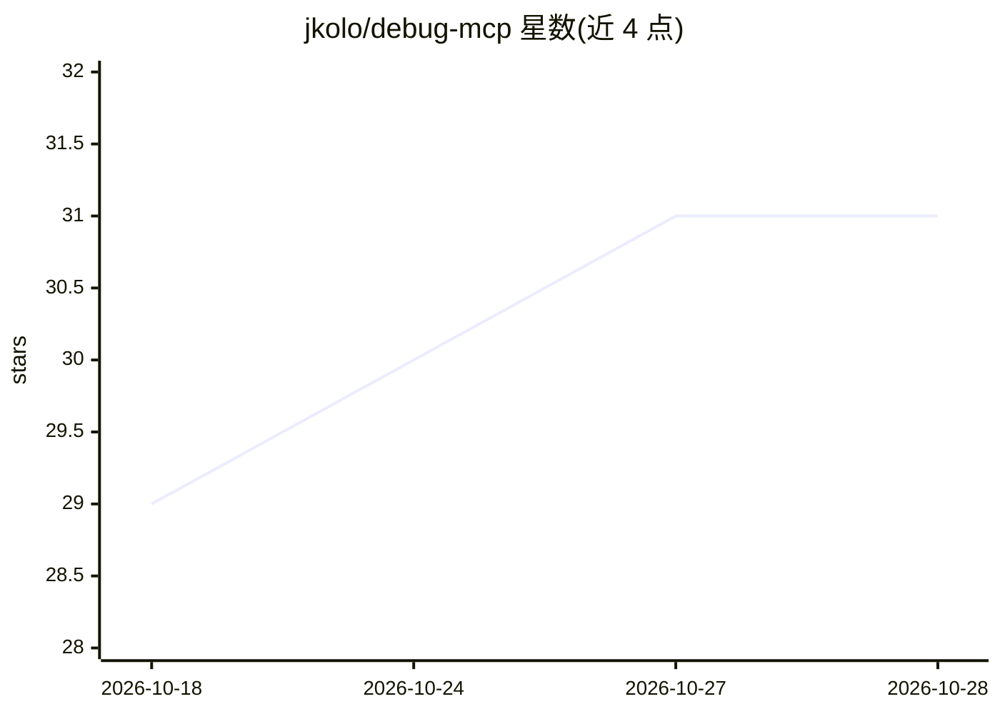

# jkolo/debug-mcp

⭐ 31 · C# · AGPL-3.0 · 推送 2026-08-26 · [GitHub](https://github.com/jkolo/debug-mcp) · [官网](https://debug-mcp.net) · 个人维护

**让 AI agent 交互式调试 .NET 应用的 MCP 服务器**

基于 ICorDebug API 直接对接 .NET 运行时的 Model Context Protocol 服务器，把调试能力暴露为 34 个结构化工具和 4 个资源，覆盖启动/附加进程、断点与异常断点、单步执行、变量与内存检查、异常全景分析（exception autopsy）以及 Roslyn 驱动的代码导航。面向使用 Claude、GPT、Copilot 等 AI 助手的开发者。要求 .NET 10 SDK 及以上，当前仅支持 Linux（Windows/macOS 支持在计划中），通过 dnx 免安装运行。

## 筛选速览

| 维度 | 判定 | 备注 |
|---|---|---|
| AI 角色 | `ai-ecosystem` | LLM/agent 周边工具 |
| 许可风险 | `viral` | AGPL-3.0 |
| 部署形态 | `None` |  |
| 模型依赖 | — | README 未给出锁定关系 |
| 硬件要求 | — | 无带数字的原话,不猜 |
| 安装摩擦 | `medium` | 含编译或系统依赖之一 |
| 成熟度 | — | 结构信号不足 |

## 能力要点

- 34 个 MCP 工具：断点/异常断点/tracepoint、单步、变量与内存检查
- 通过 ICorDebug API 直接对接 .NET 运行时，非 DAP 外部调试器
- exception_get_context 一次调用获取异常全景（类型/堆栈/局部变量）
- Roslyn 驱动的 go-to-definition、find usages 与诊断工具

## 适用场景

- 让 AI 助手启动并调试我的 .NET 应用定位空引用
- 通过对话设置异常断点追踪异常来源
- 在 MCP 客户端中检查运行中的 .NET 进程状态与内存

## 场景标签

`编码 Agent` · 领域:编码与开发

## 证据(README 行号)

> L9: **MCP server for .NET debugging** — enable AI agents to debug .NET applications interactively.
> L13: debug-mcp is a Model Context Protocol server that exposes .NET debugging capabilities as structured API tools. It a

## 星数曲线

2026-10-18 29 → 2026-10-28 31（+2）

---
*卡片 v1 · prompt 1.4 · 生成 2026-10-26 · 置信度 high · 依据 README sha `f8463aa79bc7` · [字段定义](../../DATASET.md)*
