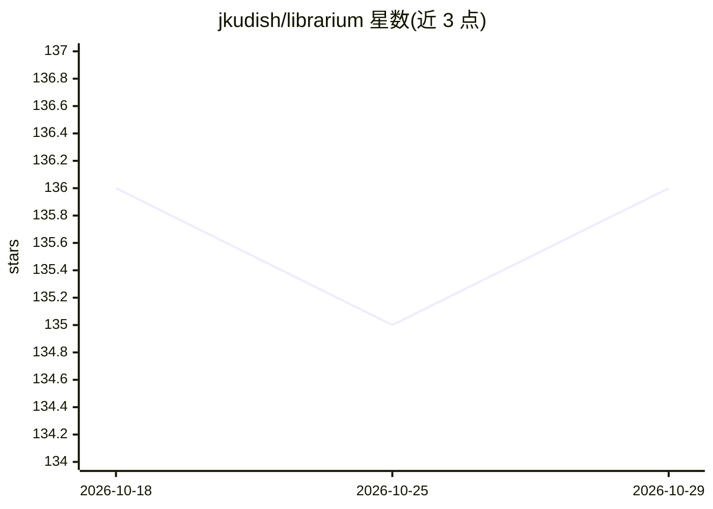

# jkudish/librarium

⭐ 136 · TypeScript · MIT · 推送 2026-10-28 · [GitHub](https://github.com/jkudish/librarium) · [官网](https://librarium.si) · 个人维护

**多供应商深度研究 CLI：并行调用搜索/AI API 并保留证据出处**

面向用户和 agent 的命令行深度研究工具：按显式 provider profile 规划研究请求，将查询并行扇出到 web 搜索、grounded 回答、消费者搜索界面观测与持久研究任务，并记录采集与访问来源（provenance）。v2 目录含 34 个内置供应商、41 个公开 profile，四种内置 workflow（quick/deep/visibility/all），支持预算上限、计划预检（plan）、可选验证（--verify）与 MCP stdio server。CLI 与 MCP server 是完整应用接口；npm 安装需 Node.js 22.12+，另有独立二进制与 Homebrew 安装。文档反复声明：供应商间一致不构成证明，引用不保证来源安全或权威。

## 筛选速览

| 维度 | 判定 | 备注 |
|---|---|---|
| AI 角色 | `ai-native` | 本体是模型或模型工具 |
| 许可风险 | `permissive` | MIT |
| 部署形态 | `library` | 以包/库形式分发 |
| 模型依赖 | locked-api |  |
| 硬件要求 | — | 无带数字的原话,不猜 |
| 安装摩擦 | `low` | 无编译、无系统依赖或容器化 |
| 成熟度 | — | 结构信号不足 |

## 能力要点

- 34 个内置供应商 / 41 个公开 profile，profile 为选择与溯源单元
- 四种内置 workflow，支持并发、超时与美元预算上限（--max-cost）
- plan 命令在本地预检预算与凭据引用而不发起供应商请求
- 结果保留 collection/access provenance，可选有界验证（--verify）

## 适用场景

- 跨多个搜索与 AI API 并行开展深度研究并比较答案
- 为 agent 通过 MCP 接入多供应商研究能力
- 在硬预算约束下执行付费研究任务并事前预检计划

## 场景标签

`科研工具` · 领域:学习与行业

## 证据(README 行号)

> L22: Librarium plans a research request against explicit provider profiles, executes
> L42: The `librarium` CLI and its MCP stdio server are the complete application

## 星数曲线

2026-10-18 136 → 2026-10-29 136（+0）

---
*卡片 v1 · prompt 1.4 · 生成 2026-10-22 · 置信度 high · 依据 README sha `fea638038d65` · [字段定义](../../DATASET.md)*
