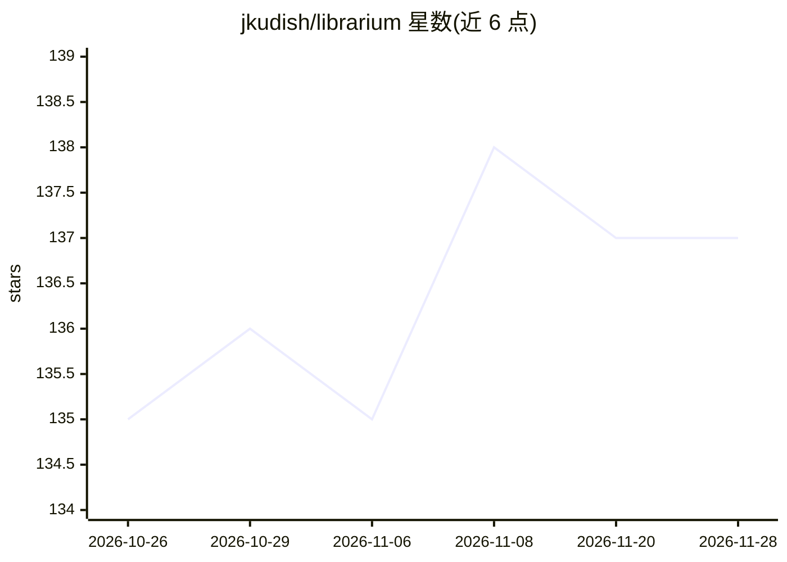

# jkudish/librarium

⭐ 137 · TypeScript · MIT · 推送 2026-11-27 · [GitHub](https://github.com/jkudish/librarium) · [官网](https://librarium.si) · 个人维护

**把一个研究问题发给多个搜索与 AI 源并保存答案、引用与成本的工具**

Librarium 将单个研究问题并行发给用户选定的 16 个搜索/AI 源与 6 个 AI 回答引擎，逐源保存答案、引用数与报告成本为可恢复的 Run，支持 --deep 持久任务、--max-cost 预算上限与 summarize 二次汇总。以 CLI、stdio MCP server（research/get_run/list_sources 三个工具）和 JavaScript 库三种形态提供，另含 Laravel 包。运行需 Node.js 22.12+ 或独立二进制，且至少一个源的 API key，调用源可能产生费用。

## 筛选速览

| 维度 | 判定 | 备注 |
|---|---|---|
| AI 角色 | `ai-ecosystem` | LLM/agent 周边工具 |
| 许可风险 | `permissive` | MIT |
| 部署形态 | `library` | 以包/库形式分发 |
| 模型依赖 | locked-api |  |
| 硬件要求 | — | 无带数字的原话,不猜 |
| 安装摩擦 | `low` | 无编译、无系统依赖或容器化 |
| 成熟度 | — | 结构信号不足 |

## 能力要点

- 16 个研究源与 6 个 AI 回答引擎统一发起并汇总结果
- Run 持久化：答案、引用、成本可保存、恢复与导出（html/jsonl）
- MCP server 供编码 agent 调用，附带 SKILL.md 技能安装
- --max-cost 预算控制与 usage 成本统计

## 适用场景

- 让一个问题同时发给多个搜索与 AI 源并对比答案与引用
- 为 Claude Code 等编码 agent 提供研究查询工具
- 追踪多次研究查询的累计花费（usage 命令）
- 批量观测各 AI 产品对同一问题的回答（visibility 组）

## 场景标签

`科研工具` · 领域:学习与行业

## 证据(README 行号)

> L112: The `mcp` command (`librarium mcp`) runs a stdio MCP server with three tools:
> L84: There are 16 research sources: `brave`, `claude`, `exa`, `firecrawl`,
> L10: Librarium sends one research question to the search and AI sources you

## 星数曲线

2026-10-26 135 → 2026-11-28 137（+2）

---
*卡片 v1 · prompt 1.4 · 生成 2026-11-28 · 置信度 high · 依据 README sha `e90177d76b13` · [字段定义](../../DATASET.md)*
