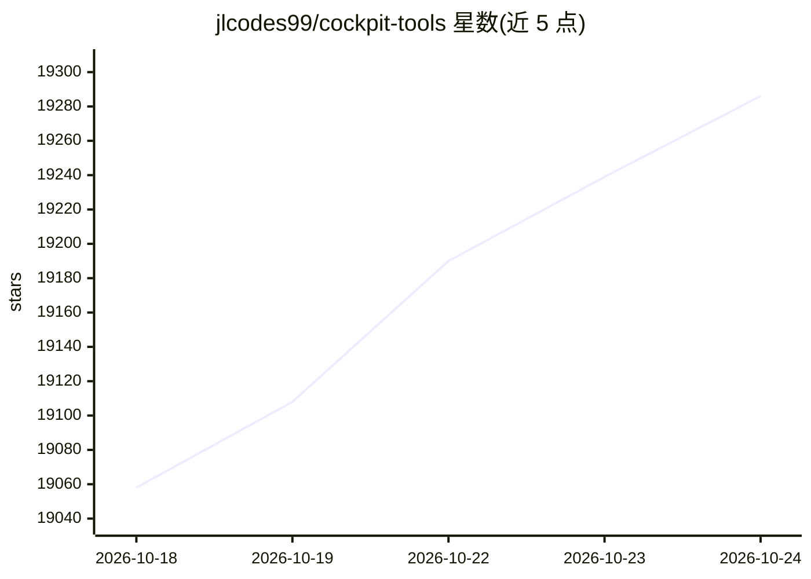

# jlcodes99/cockpit-tools

⭐ 19,304 · Rust · 推送 2026-10-24 · [GitHub](https://github.com/jlcodes99/cockpit-tools) · [官网](https://github.com/jlcodes99/cockpit-tools#readme) · 个人维护 · 中文 README

**多平台 AI IDE 账号管理桌面工具：一键切号、配额监控与应用多开**

本地运行的桌面工具，管理 Antigravity、Codex、GitHub Copilot、Windsurf、Kiro、Cursor、Grok CLI、CodeBuddy、Qoder、Trae、Zed、ZCode 等 16 个 AI IDE/CLI 平台的账号：支持一键切号、Token/OAuth 导入、配额与套餐查询、定时唤醒任务以及同平台多账号多实例并行运行（实例目录与启动参数隔离）。Codex 部分内置 Rust 原生与 Go CLIProxyAPI 两种 API 服务引擎，提供 Responses 兼容接口与 Claude/Gemini/Ollama 兼容接口。支持 macOS、Windows、Linux，界面提供 18 种语言。

## 筛选速览

| 维度 | 判定 | 备注 |
|---|---|---|
| AI 角色 | `ai-enhanced` | 去掉 AI 部分产品仍成立 |
| 许可风险 | `none` | — |
| 部署形态 | `desktop` | 安装包/桌面程序 |
| 模型依赖 | local-ok | 支持本地模型 |
| 硬件要求 | — | 无带数字的原话,不猜 |
| 安装摩擦 | `low` | 无编译、无系统依赖或容器化 |
| 成熟度 | — | 结构信号不足 |

## 动量与使用信号

- 维护:`active` — 距上次 push 0.8 天,年发版 100,78 位贡献者
- 涨星:近 1 天 **+33**(自 20261016 起算)
- 平台:WINDOWS / MACOS / LINUX · 协议:MCP / OLLAMA

## 能力要点

- 16 个 AI IDE/CLI 平台的账号管理与一键切换
- 配额/套餐监控与定时唤醒任务
- 同平台多账号多实例并行运行，实例目录与参数隔离
- Codex API 服务：Rust 原生与 Go CLIProxyAPI 双引擎，提供 Claude/Gemini/Ollama 兼容接口

## 适用场景

- 在多个 AI IDE 账号之间快速切换，避免手动登录登出
- 同时开多个 IDE 实例分别绑定不同账号处理不同项目
- 查看各平台剩余配额与重置时间，提前触发配额重置周期

## 场景标签

 · 领域:AI 开发者工具/桌面工具

## 证据(README 行号)

> L10: 一款**通用的 AI IDE 账号管理工具**，目前支持 **Antigravity IDE**、**Codex**、**GitHub Copilot**、**Windsurf**、**Kiro**、**Cursor**、**Gr
> L12: > 本工具旨在帮助用户高效管理多个 AI IDE 账号，支持一键切换、配额监控、自动唤醒与应用多开并行运行，助您充分利用不同账号的资源。
> L20: **官方支持平台**：macOS、Windows、Linux。

## 星数曲线

2026-10-18 19,058 → 2026-10-24 19,286（+228）

---
*卡片 v1 · prompt 1.4 · 生成 2026-10-20 · 置信度 mid · 依据 README sha `96accb1a9b5e` · [字段定义](../../DATASET.md)*
