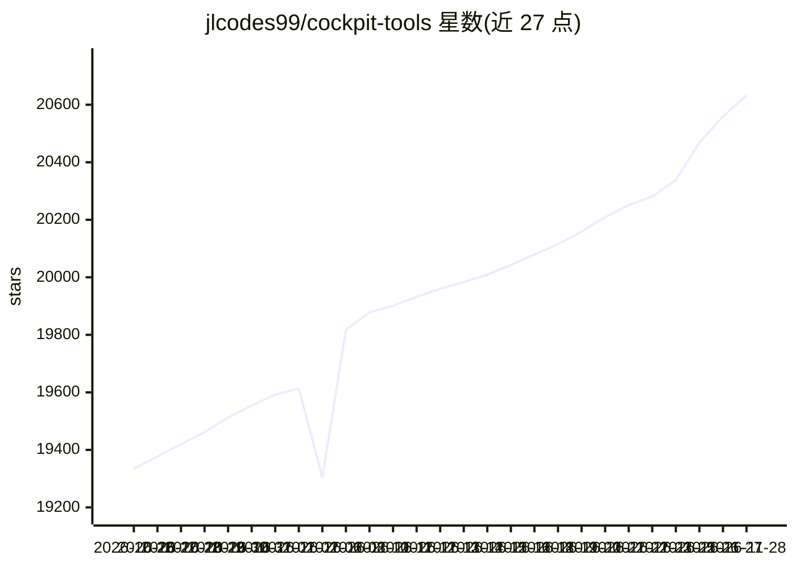

# jlcodes99/cockpit-tools

⭐ 20,633 · Rust · 推送 2026-11-27 · [GitHub](https://github.com/jlcodes99/cockpit-tools) · [官网](https://github.com/jlcodes99/cockpit-tools#readme) · 个人维护 · 中文 README

**管理多款 AI IDE 账号的桌面工具：切号、配额监控、多开**

本地桌面工具，统一管理 Antigravity、Codex、GitHub Copilot、Windsurf、Cursor 等 18 款 AI IDE/CLI 的账号：支持 OAuth 与 Token/JSON 导入、一键切号注入并启动客户端、配额与套餐用量展示、账号多开实例的独立目录与生命周期控制。内置 Rust 引擎提供 API 服务，支持 Responses/Claude/Gemini/Ollama 协议兼容、账号池与自动唤醒任务。数据保存在本机 ~/.cockpit_tools 目录。提供 macOS、Windows、Linux 版本与 18 种语言界面。

## 筛选速览

| 维度 | 判定 | 备注 |
|---|---|---|
| AI 角色 | `ai-ecosystem` | LLM/agent 周边工具 |
| 许可风险 | `none` | — |
| 部署形态 | `desktop` | 安装包/桌面程序 |
| 模型依赖 | local-ok | 支持本地模型 |
| 硬件要求 | — | 无带数字的原话,不猜 |
| 安装摩擦 | `low` | 无编译、无系统依赖或容器化 |
| 成熟度 | — | 结构信号不足 |

## 动量与使用信号

- 维护:`active` — 距上次 push 0.8 天,年发版 100,78 位贡献者
- 涨星:近 1 天 **+33**(自 20261016 起算)
- 平台:WINDOWS / MACOS / LINUX · 协议:MCP / OLLAMA

## 能力要点

- 18 款 AI IDE/CLI 的账号统一管理与一键切号注入
- 配额监控仪表盘：展示剩余额度、重置时间与订阅计划
- 应用多开：独立用户目录、参数隔离与并行实例启停
- 内置 Rust 引擎 API 服务，兼容 Responses/Claude/Gemini/Ollama 协议

## 适用场景

- 同一 AI IDE 持有多个订阅账号，需要快速切换使用
- 同时运行多个 IDE 实例分别处理不同项目
- 统一查看各平台订阅配额消耗与重置周期

## 场景标签

 · 领域:开发者工具/AI IDE 账号管理

## 证据(README 行号)

> L10: 一款**通用的 AI IDE 账号管理工具**，目前支持 **Antigravity IDE**、**Codex**、**GitHub Copilot**、**Windsurf**、**Kiro**、**Cursor**、**Gr
> L12: > 本工具旨在帮助用户高效管理多个 AI IDE 账号，支持一键切换、配额监控、自动唤醒与应用多开并行运行，助您充分利用不同账号的资源。
> L88: - **API 服务**：统一由宿主内的 Rust 引擎运行，支持 Responses HTTP/SSE/WebSocket、上下文压缩及 Chat Completions、Claude、Gemini、Ollama 协议兼容。旧 

## 星数曲线

2026-10-26 19,334 → 2026-11-28 20,633（+1,299）

---
*卡片 v1 · prompt 1.4 · 生成 2026-11-28 · 置信度 mid · 依据 README sha `a7b61d508eb8` · [字段定义](../../DATASET.md)*
